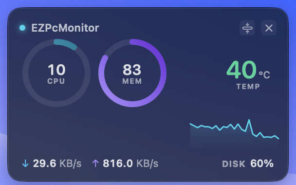
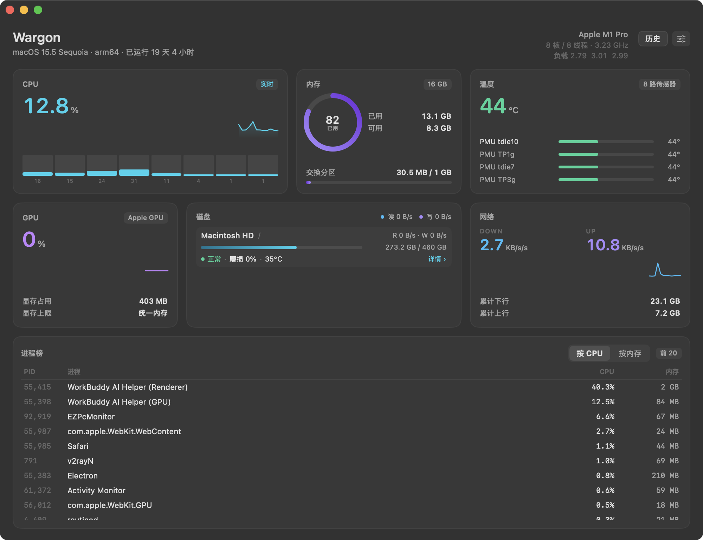
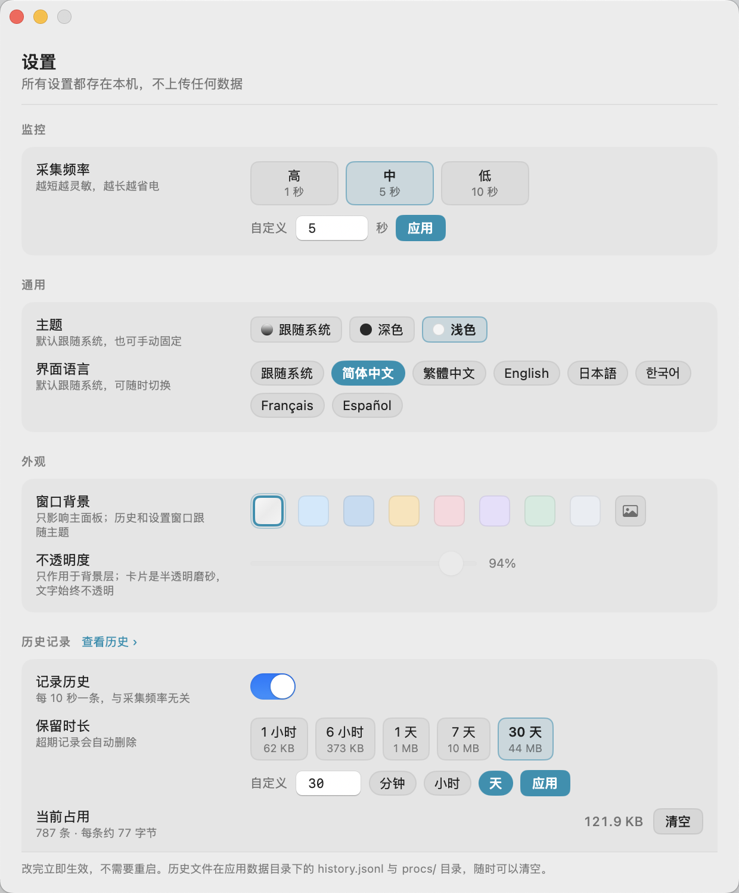
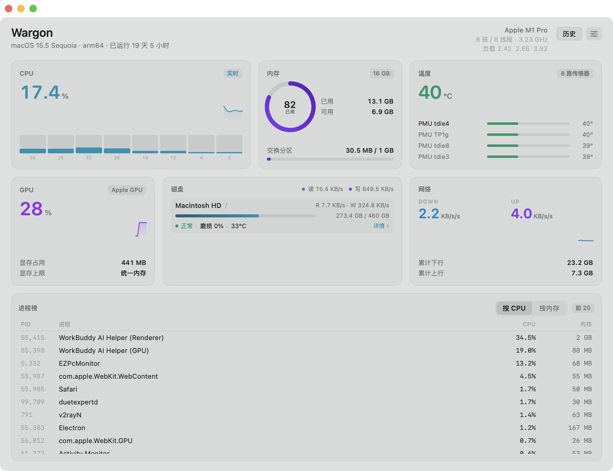
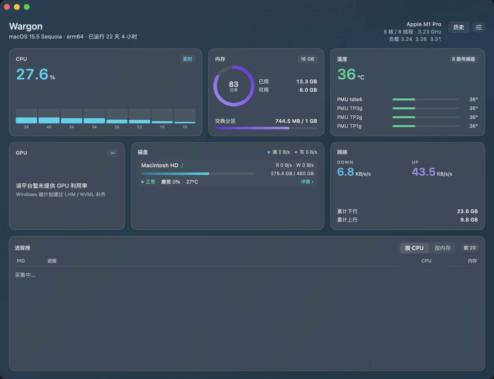
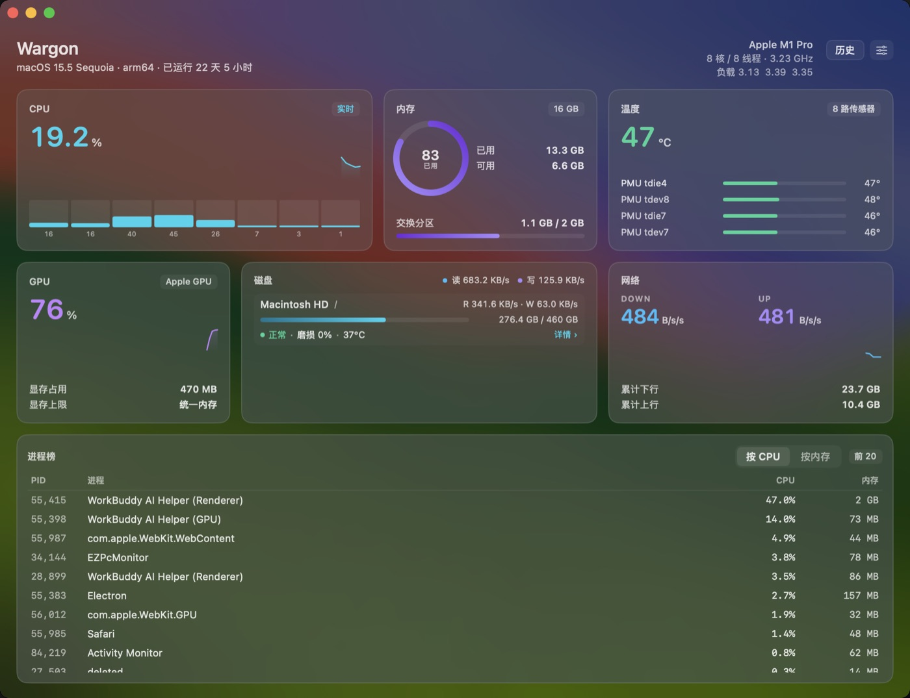
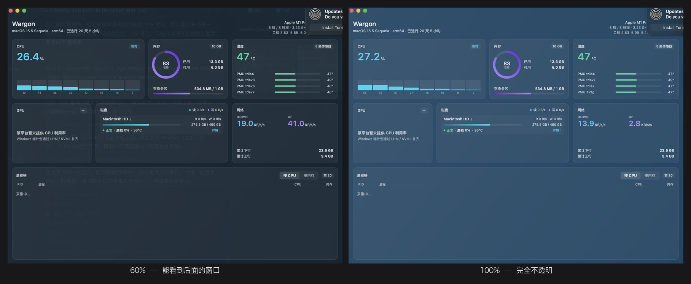
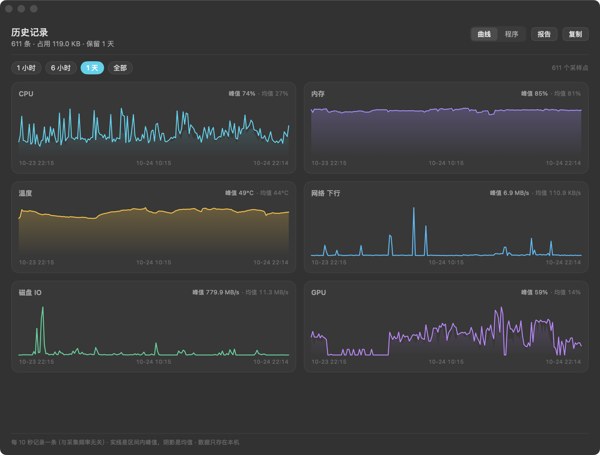
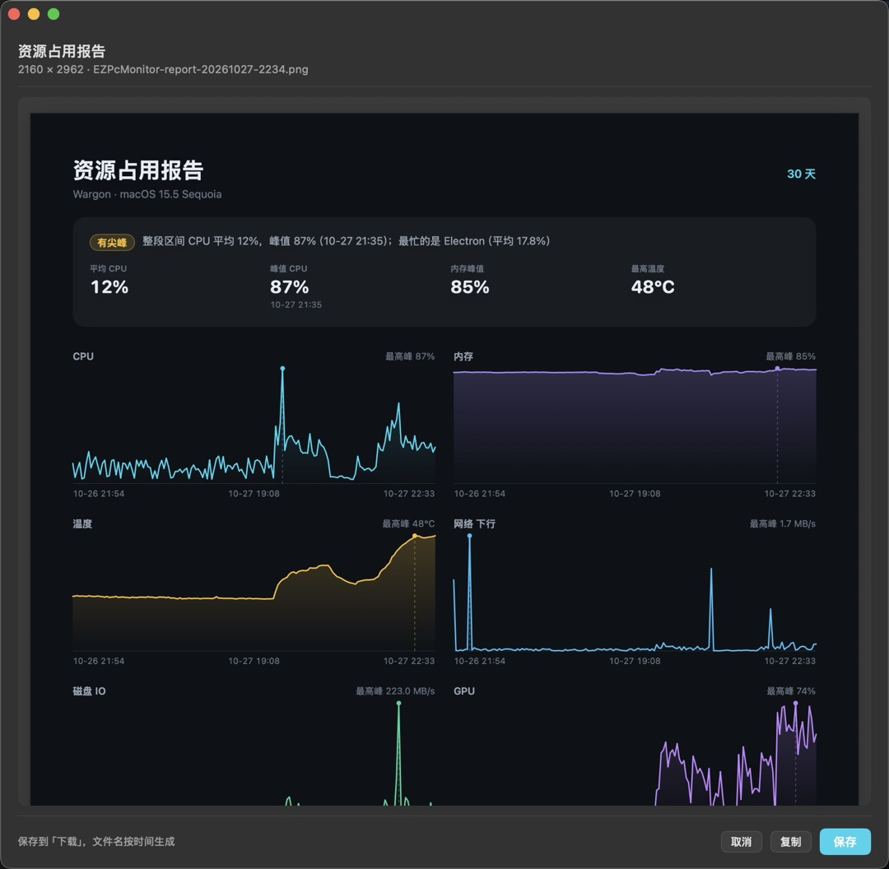
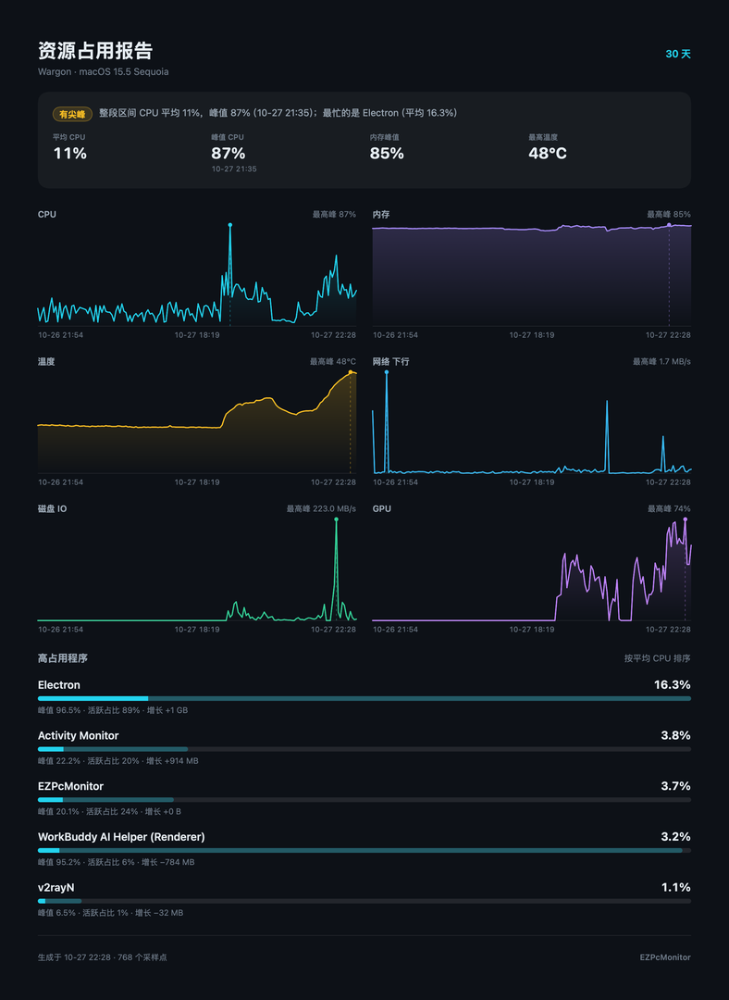

# EZPcMonitor

跨平台轻量级 PC 硬件监控 · 半透明悬浮窗 · macOS 原生版

监控 **CPU / 内存 / 磁盘 / 网络 / 温度 / GPU**，用一块毛玻璃悬浮窗常驻桌面，双击展开完整主面板。

<p align="center">
  
</p>

<p align="center">
  
</p>

<p align="center">
  
</p>

## v0.2：外壳换成原生的

v0.1 是 Tauri 2 + React：Rust 采集，前端画界面，WebView 渲染。功能齐了，但两件事一直别扭——

一个是开销：一个监控软件自己占 71 MB 主进程 + 三个 WebKit 辅助进程，合计 166 MB，
「轻量」这两个字站不住。另一个是外观：毛玻璃是系统给的，可阴影、圆角、字体、动画
全都要跟 WebView 的 CSS 打架，最后做出来的是「网页在模仿 macOS」，不是 macOS。

v0.2 把**外壳**整个重写成 AppKit + SwiftUI，**采集内核一行没动**：Rust 还在 `core/`，
中间隔一层 C ABI + JSON。没有 WebView，没有 JS 运行时，也没有打包器。

| | Electron | Tauri 2（v0.1） | **原生（v0.2）** |
|---|---|---|---|
| 安装包 | 90–150 MB | 4.12 MB | **5.9 MB** |
| 常驻内存 | 150–300 MB | 71 MB（主进程）/ 166 MB（全进程） | **18 MB**（`phys_footprint`） |
| 主面板打开 | — | 166 MB | **33 MB** |
| 常驻 CPU | 3–8% | 2.4% 单核 | **约 5.5% 单核**（1 秒采集）· **约 1%**（5 秒采集） |
| 渲染 | Chromium | WebKit | AppKit / SwiftUI |
| 温度采集 | 需要 native 插件 | Rust 直连 IOKit | Rust 直连 IOKit |

`.app` 比 Tauri 版还大 1.8 MB，是因为 Tauri 那 4.12 MB 根本没算 WebKit——它借系统的。
原生版 5.9 MB 里有 705 KB 是自带的 `smartctl`，剩下是 4.9 MB 的二进制和图标。
**内存差 4 倍，这才是重点。**

CPU 那行不是笔误：1 秒一拍时确实要 5.5%，其中采集内核约 1%，其余是每秒重绘整块毛玻璃。
默认留 1 秒是因为曲线要跟手；只想挂着看，在设置里改成 5 秒，占用掉到 1% 左右。

## 特性

- **真·半透明**：`NSVisualEffectView` 的 `.behindWindow` 混合，桌面内容实时透过来，不是静态模糊图
- **主面板背景可换**：系统材质 / 七种纯色（天蓝 · 海蓝 · 落日黄 · 珊瑚 · 紫罗兰 · 墨绿 · 石墨，着色玻璃，桌面照样透过来）/ 自己选一张照片（磨砂处理）。不透明度单独一根滑杆（10%~100%），只作用于背景层；卡片是半透明的磨砂，**文字始终不透明**
- **无边框感的窗口**：背景一直铺到窗口顶边（红绿灯那条也在背景上，不是一块透到桌面的空白），标题栏只剩三个红绿灯，正文和标题栏之间那条分隔线去掉了；正文自动让开红绿灯，窗口任意空白处都能拖
- **两种形态**：卡片（双环 + 温度 + 趋势）/ 紧凑条（单行）。条模式右键会把整条换成操作按钮，双击展开回卡片
- **主面板与悬浮窗互斥**：桌面上永远只有一个——打开面板自动收起悬浮窗，关掉面板再放回来；反过来点悬浮窗的 ✕ 只收起挂件，不会把主面板翻出来
- **点图标就开面板**：菜单栏图标左键直接开主面板（已经开着就提到前面），右键（或 Control-点）才弹菜单；Dock 里点图标同样开主面板
- **菜单栏图标就是 App 图标那条心电折线**：同一份几何数据生成，抠成模板图（`isTemplate`），深色栏上是白的、浅色栏上是黑的，不另画一套
- **托盘全控**：主面板开 / 关、悬浮窗显示 / 隐藏、形态切换（卡片 / 紧凑条）、不透明度（100/90/80/70/60%，只作用于背景层，文字始终实心）、采集频率都在菜单里点，偏好下次启动还记得
- **采集频率可调**：高（1 秒）/ 中（5 秒）/ 低（10 秒）三档 + 自定义（0.5–60 秒），托盘菜单和主面板齿轮都能改，改完当拍生效并记住
- **历史可回溯**：开启后每 10 秒记一条，保留 1 小时到 30 天（或自定义），点「历史」就能看过去六项指标的曲线和峰值。**默认关闭**，写不写盘你说了算
- **程序榜**：历史窗口里切到「程序」，按进程名合并出 top10 高占用榜，CPU / 内存 / 磁盘三个维度、按平均 / 峰值 / 活跃占比 / 增长任意排序——直接回答「刚才是谁卡的我」
- **一键报告**：一张 PNG 长图装下结论、六项走势和 Top5 高占用程序。先预览再决定保存 / 复制 / 取消，点了「报告」不等于往磁盘上写东西
- **设置窗口**：监控 / 通用 / 外观 / 历史记录 / 关于分组，齿轮和托盘「设置…」进的是同一个地方
- **深色 / 浅色两套配色**：默认跟随系统，也可以手动固定；`NSColor(name:dynamicProvider:)` 让同一份代码在两种外观下各出一套色，浅色不是「把深色调亮」，是重新配的一版
- **七种界面语言**：简体中文 / 繁體中文 / English / 日本語 / 한국어 / Français / Español，默认跟随系统语言，设置里随时切换，**不用重启**——托盘菜单和窗口标题跟着一起变
- **GPU 独立成卡**：利用率曲线 + 显存占用，和磁盘并列在第二行
- **不挡操作**：一键鼠标穿透（`ignoresMouseEvents`），全屏游戏里也安全
- **悬浮窗不抢焦点**：`NSPanel` + `.nonactivatingPanel`，点它不会把你正在用的 App 挤到后台
- **硬盘工具**：容量、实时读写、健康状态一眼可见；点开二级页看完整 SMART 属性表、实时曲线，还能跑顺序和 4K 随机读写测速。**`smartctl` 随包自带**，不用另装
- **按需采集**：悬浮窗只采必要指标，进程列表仅主面板可见时采集
- **零网络**：没有遥测、不联网；除设置文件外不写盘，历史记录需要你手动开启

## 快速开始

```bash
# 依赖：Xcode Command Line Tools / Rust 1.80+
#      Node 22 是可选的，只用来从 TS 字典导出 strings.json（没有就沿用已有的）
./macos/build.sh          # 构建 → macos/build/EZPcMonitor.app
./macos/build.sh --open   # 构建并启动
./macos/build.sh --debug  # 不优化（快，但别拿它量内存和 CPU）
```

验收/截图用的启动参数，直接拉对应窗口，省得去点菜单栏图标：

```bash
./macos/build/EZPcMonitor.app/Contents/MacOS/EZPcMonitor --dashboard
./macos/build/EZPcMonitor.app/Contents/MacOS/EZPcMonitor --history
./macos/build/EZPcMonitor.app/Contents/MacOS/EZPcMonitor --settings
./macos/build/EZPcMonitor.app/Contents/MacOS/EZPcMonitor --history --report       # 开报告预览
./macos/build/EZPcMonitor.app/Contents/MacOS/EZPcMonitor --history --report-save  # 预览 + 存一张到「下载」
```

`--report-save` 单独拆出来是为了量内存：渲一次 2160×2734 的位图会把 footprint 抬高
二十多兆，顺手写盘会让读数失真。

## 项目结构

```
├── core/                      Rust 采集内核（跨平台，不认识 Swift）
│   ├── include/ezpcm_core.h   C ABI，宿主只需要这一个头文件
│   └── src/
│       ├── engine.rs          ezpcm_call 的方法分发
│       ├── metrics.rs         采集内核（CPU / 内存 / 磁盘 / 网络 / 温度）
│       ├── diskhealth.rs      硬盘健康（diskutil + smartctl）
│       ├── bench.rs           测速（顺序 + 4K 随机）
│       ├── gpu.rs             GPU provider
│       ├── history.rs         历史记录（JSONL + 按保留时长修剪）
│       ├── procstats.rs       程序榜（小时分片 JSONL + 按名字合并统计）
│       ├── settings.rs        设置持久化
│       └── i18n.rs            内核侧的文案（SMART 属性名等）
├── macos/                     macOS 外壳（AppKit + SwiftUI）
│   ├── Sources/EZPcMonitor/
│   │   ├── App/               Main · AppDelegate · AppModel · 菜单栏
│   │   ├── Core/              Engine(C ABI 封装) · Models · History · Leaders · L10n
│   │   └── UI/                悬浮窗 · 主面板 · 背景 · 历史 · 设置 · 磁盘详情 · 报告图 · 报告预览 · 组件
│   ├── i18n/                  七份字典（TS 源码，构建时导出 JSON）
│   ├── Resources/             Info.plist · AppIcon.icns · tray-template*.png · strings.json · bin/smartctl
│   ├── tools/                 extract-strings.mjs（TS → strings.json）
│   └── build.sh               构建入口
├── docs/                      技术方案 / 决策记录 / 截图
├── scripts/
│   ├── gen_icon.py            画 1024² 应用图标（纯标准库）
│   └── gen_tray_icon.py       同一条折线 → 菜单栏模板图（1x/2x/3x）
└── app-icon.png               图标源图（gen_icon.py 生成，再用 iconutil 转 .icns）
```

## 架构：Rust 内核 + C ABI + SwiftUI

内核对外只有**四个符号**：

```c
EzpcmEngine *ezpcm_engine_new(data_dir, config_dir, bundled_smartctl);
char        *ezpcm_call(engine, method, args);   /* 返回 UTF-8 JSON，失败也是 JSON */
void         ezpcm_string_free(char *s);
void         ezpcm_engine_free(engine);
```

`ezpcm_call` 是唯一的数据入口，方法名走字符串（`snapshot` / `recent` / `history` /
`leaders` / `health` / `bench` / `settings` / `patch` …），参数和返回值都是 JSON。

三个选择值得说明：

**为什么不用绑定生成器。** UniFFI 那类工具解决的是「结构体很多、要自动对齐」的问题，
这里恰好不是——内核对外十几个方法，为它引一套代码生成 + 构建插件，维护成本大于收益。
手写一层 C ABI 一共四个函数，一页纸看得完。

**为什么是 JSON 而不是 C struct。** 加一个指标不用动 ABI：内核里加字段，Swift 侧的
`Decodable` 多一个 `let`，二进制契约不变。换成 struct 就要重新对齐内存布局、重新定版本。
历史文件本来就是 JSONL，形状天然一致。1 秒一拍的量级上，序列化开销测不出来。

**为什么外壳轮询、内核不回调。** 跨语言回调要把函数指针和生命周期一起管：内核线程
持有 Swift 闭包，Swift 对象释放时内核还在回调，这类崩溃只在偶发时机出现。轮询把并发
问题关在内核内部（一把锁），外壳只看得到「一次同步函数调用」；返回里带 `seq`，
没变就不重绘。

主面板、历史、设置三个窗口各自独立持有视图，关掉就整个放掉——`NSHostingView` 里的
表格和进度条不该在关窗之后继续占内存。

## 平台支持

| 指标 | macOS 13+ | Windows | Linux |
|---|---|---|---|
| CPU / 内存 / 磁盘 / 网络 / 磁盘测速 | ✅ | 内核已实现，缺外壳 | 内核已实现，缺外壳 |
| 温度 | ✅ 无需 root | 同上 | ✅ 无需 root |
| GPU 利用率 | ✅ | 同上 | ✅ amdgpu |
| 硬盘健康 / 寿命 | ✅ 自带 smartctl，免安装 | 同上 | ✅ 自带 / 系统包 |

`core/` 里的 `cfg(target_os)` 分支都还在（Windows 走 WMI / PDH，Linux 读 `/proc` 和 sysfs），
C ABI 也是跨平台的。**缺的只是外壳**：要支持 Windows / Linux，得再写一套 UI。

## 硬盘工具

一级页面（主面板磁盘卡）只放一眼能看懂的东西：容量、实时读写、一行状态。**复杂信息
全部收进二级页**——点磁盘行打开，里面有完整属性表、实时读写曲线和顺序 / 随机读写测速。

**盘多的时候在卡里滚。** 磁盘卡是固定的 178pt 高，不随窗口变大——多出来的高度留给
进程榜。一行磁盘约 54pt，整行放得下 2 块，第 3 块就开始溢出：

- 溢出时卡片底边压一层 22pt 的渐隐，滚到底自动消失（`remaining = 内容底边 − 视口底边`，
  两个 global 坐标相减，不依赖具名坐标空间）
- 滚动条平时不画，滚的时候才浮出来——一条常驻的滚动条在这么小的卡里比内容还抢眼
- 渐隐用 `.mask` 而不是盖一层渐变：卡片本身是半透明的，任何实色渐变都会把背后的
  桌面/照片染脏，只有把内容自己淡出去才对

数据分三层，能拿到多少报多少：

| 层 | 依赖 | 能拿到 |
|---|---|---|
| 系统级 | 无（macOS `diskutil`） | 健康状态 Verified / Failing、固态还是机械、总线类型 |
| 完整 SMART | **随包自带的 `smartctl`** | 磨损百分比、可用备用块、累计读/写量、通电时间与次数、介质错误、异常掉电、完整属性表 |
| 降级 | — | 拿不到的字段直接不显示，**不用估算值冒充实测** |

`smartctl` 已经打进 App 里（`Contents/Resources/bin/`），用户不需要装任何东西；
跑不起来（比如架构不匹配）则自动回落到系统装的那份。外置 USB 硬盘盒常见不支持
SMART 直通，这种情况会显示系统给的状态并说明原因，而不是报错。

**关于「寿命」的措辞**：界面写的是「磨损」而不是「剩余寿命」。`percentage_used` 是厂商标称
耐久度的磨损记账，**不是故障预测**——盘可能在磨损 0% 时猝死，也可能磨损 80% 还活得好好的。
所以详情页把「介质错误」这类**已经发生**的计数摆在磨损旁边，并明确写了这句提醒。

**测速**四项：顺序写 / 顺序读（256 / 512 / 1024 MB 可选）+ 4K 随机写 / 随机读（各 2.5 秒）。
顺序那两项写前 `fsync`、读时绕开 page cache；随机那两项块大小 4 KiB、队列深度 1，和
CrystalDiskMark 的 RND4K Q1T1 同口径。测完自动删除临时文件。

四项各自回答不同的问题：

| 项目 | 回答什么 |
|---|---|
| 顺序写 / 顺序读 | 这块盘**大文件**还快不快——拷素材、装系统看这个 |
| 4K 随机读 | 开程序、加载资源快不快——日常**手感**的主要来源 |
| 4K 随机写 | 小文件、日志、数据库——SSD 掉速最先在这里露出来 |

原来这里写的是「不做 4K 随机——那是跑分软件的事」，这个判断错了：顺序还能跑 2 000 MB/s、
随机读掉到 20 MB/s 的盘很常见（主控在后台做垃圾回收），而后者才是打开什么都等一下的
那种慢。随机两项按时长跑而不是按次数（NVMe 一秒几万次、机械盘一秒几十次，固定次数
要么等到天荒地老要么样本太少），随机种子固定，两次跑命中同一批偏移，比的是盘本身。

写盘量因此从「一次顺序写」变成「一次顺序写 + 2.5 秒随机写」：随机测试复用同一份文件，
512 MB 档多写约 200 MB。嫌费可以选 256 MB。

## 设置

主面板右上角齿轮，或托盘菜单 → `设置…`，打开的是同一个窗口。按功能分组：

<p align="center">
  
</p>

**监控**：采集频率高（1 秒）/ 中（5 秒）/ 低（10 秒），也可以填 0.5–60 秒的任意值。
托盘菜单里也有同样的三档，两处改的是同一份状态。

改动**当拍生效**：采集线程每轮现读一次间隔，不等当前 sleep 走完。频率存在
`settings.json`，下次启动还是这个值。

内部还有一层更慢的分级（磁盘 IO 2s / 温度 5s / 容量 30s），判断依据是**时间戳**而不是
「第几拍」，所以把主频率调到 10 秒，温度不会变成 50 秒才刷新——它跟着主拍走，只是每拍
检查一次该不该刷新。

## 主题

深色是原版，浅色是另配的一版——不是把深色反相，而是重新定了一遍：卡片改白底加淡投影、
正文用墨蓝而不是纯黑、图表曲线统一压深一档（1.6px 的线在白底上会被冲掉）。

设置 → 通用 → 主题：**跟随系统** / **深色** / **浅色**。跟随系统时会跟着 macOS 的外观
切换实时变，不用重启；手动固定后就不再管系统怎么设。

<p align="center">
  
</p>

配色用 `NSColor(name:dynamicProvider:)` 声明一次，两套色值都挂在同一个颜色上：视图代码
只说「这是次要文字」，由 AppKit 按当前 `NSApp.appearance` 决定用哪一档。切换主题因此
不需要重建窗口，也不会出现「界面变浅了、标题栏还是深的」。

### 文字层级是自定的，不用系统的 `.secondary`

主面板是**半透明**窗口，底色来自磨砂玻璃后面的桌面，明度不可控。系统的 `.secondary`
（深色下白 55%）压在常见的浅色壁纸上，实测只有 **3.1~3.4:1**，10.5pt 的卡片标题读起来
发虚；`.tertiary`（白 25%）更是只有 1.5:1，等于没画。WCAG 对小字的要求是 4.5:1。

所以文字色走 `Ink` 这套自定阶梯：**次要 72%、更弱 55%**，深浅两套各自取值。全应用统一
（主面板、悬浮窗、历史、设置、报告），同一个视觉角色在两个窗口里不该长得不一样。

只提亮文字还不够——白字压在浅底上照样糊。同时做两件事：卡片底色从 3.5% 提到 5.5%
（描边 9%），让「哪里是卡片」看得出来；材质和纯色背景都压一层 26% 的纱，把底色拉到
可预期的范围，不再由壁纸明暗决定可读性。

（后来背景改成真透明，卡片那层 5.5% 的平色又不够用了——换成了磨砂面板，见
[主面板背景](#主面板背景) 那节。）

改完之后实测（深色 / 系统材质）：副标题 **3.40 → 7.31:1**、卡片标题 **3.14 → 6.56:1**、
表头 **3.24 → 6.56:1**、大数值 **3.53 → 6.08:1**、PID 列 **~3.4 → 4.51:1**。

## 主面板背景

设置 → 外观 → 窗口背景。三档，都只影响主面板，历史和设置窗口跟随主题：

| 档位 | 怎么画的 |
|---|---|
| 系统材质（默认） | `NSVisualEffectView` 的 `.underWindowBackground`，磨的是窗口背后的桌面，跟着桌面内容实时变 |
| 纯色（7 种） | 同一层材质打底，再盖一层带透明度的色——macOS 的「着色玻璃」，颜色是染上去的，底下的桌面依然被磨过 |
| 自定义图片 | 导入时缩到 720px、高斯磨好、存成 45 KB 的 JPEG；合成时上面再盖一层材质负责压暗和降饱和 |

<p align="center">
  
</p>

七档色：天蓝 / 海蓝 / 落日黄 / 珊瑚 / 紫罗兰 / 墨绿 / 石墨。前五个是主流鲜艳色，后两个
压得住，挂一整天不扎眼。

| 色 | 深色 | 浅色 | 副标题对比度（不透明度 72%） |
|---|---|---|---|
| 天蓝 `sky` | `#1573B8` | `#CFE9FC` | 5.23:1 |
| 海蓝 `ocean` | `#0F4677` | `#C2DCF2` | 7.15:1 |
| 落日黄 `sunset` | `#8C4A08` | `#FBE3B8` | 6.13:1 |
| 珊瑚 `coral` | `#8E3346` | `#FAD8DE` | 6.53:1 |
| 紫罗兰 `violet` | `#4B347E` | `#E6DFFB` | 7.15:1 |
| 墨绿 `forest` | `#1B4A3A` | `#D2EBDF` | 7.12:1 |
| 石墨 `graphite` | `#3D4453` | `#E9EDF3` | 7.11:1 |

**鲜艳的那几档是「深色调的高饱和」，不是色卡上的原色。** 天蓝取了 `#1573B8`——正宗天空蓝
在这一层染色上刚好压线，副标题 5.23:1，再往亮挪一格白字就掉到 3:1 以下。所以做法是
**色相拉满、明度压住**：看上去仍然一眼是天蓝、海蓝、落日黄，但白字读得清。落日黄第一版
取 `#7F4E08`，实测偏棕，往橙挪了一格才像落日。

图片那档为什么在**导入时**磨而不是合成时磨：照片是静止的，磨出来的像素每次都一样，
实时磨等于每帧重算一遍同样的结果。而且开销基本正比于图片像素数——同一张图 1400px 让
主面板从 31 MB 涨到 47 MB，720px 只有 36 MB，两者显示出来是同一片渐变（模糊之后 15px
以上就没有细节了）。完整的拆解表在 [docs/PERF.md](docs/PERF.md)。

<p align="center">
  
</p>

色块的点击语义：没选过图 → 弹文件面板；选过但没在用 → 应用它；正在用 → 不动，换图走
右键菜单（换一张… / 清空）。

**那根「不透明度」滑杆就是窗口的不透明度。** 100% 是一块实色（桌面完全盖住），10% 能看清
后面窗口里的字。滑杆作用在**整层背景**上，磨砂材质和染色在层内保持满强度——所以不管拉
到哪里，窗口都还是同一个色相，只是后面露出多少不同。

```swift
ZStack {
    glass.opacity(alpha)   // 滑杆作用在这里
    veil                   // 纱在层外，不跟着一起降
}
```

**纱为什么必须在 `.opacity()` 外面。** 它负责把最终画面压到「白字还能读」的范围。放在层内
的话，滑杆一降它也跟着降，等于什么都没兜住。放在层外，它挡的是到达眼睛的最终像素——不管
后面是壁纸、别的窗口还是一张照片，亮度都有上限。强度跟着滑杆反向走（越透明越需要兜），
深色纯色那档 0.38 → 0.10。浅色主题的纱用**预设色自己**而不是白：白纱盖在浅色染色上会把
色相洗没（选了 ocean 得到一片白）。

**代价是低不透明度时后面是清晰的**，不是磨砂的——`NSVisualEffectView` 的透光率实测只有
~17%（白窗垫底，窗口底色只亮 14/255），单靠它永远看不出后面有东西。要「看得见」就得把整层
降下来，磨砂就只占 `alpha` 那一部分。

下限放在 10%：这一档后面已经能读字，再往下就只剩一层纱。可读性由外面那层纱兜着——纯白
窗口垫底、滑杆 10%，白 72% 的副标题实测仍有 4.85:1（WCAG 对小字要求 4.5）。

**卡片是磨砂的，和背景不是同一种「透明」。** 背景是「透」的，卡片是「糊」的：

```swift
MaterialView(material: .popover, blending: .withinWindow)  // 糊窗口里那层背景
Color.white.opacity(深色 0.12 / 浅色 0.42)                  // 提亮，把区块托起来
```

用 `.withinWindow` 而不是系统默认的 `.behindWindow`：卡片该糊的是**窗口自己的背景**（染色
或照片），不是桌面。用 SwiftUI 的 `.thinMaterial` 试过一版，它铺在纯色上，卡片内部和旁边
的缝隙只差 1~2 级亮度（同一张截图采样：缝隙 `(34,51,69)`，卡片 `(33,53,67)`）——等于没画，
用户的原话就是「区块和背景一种透明效果」。现在差 20 级左右，滑杆拉到 10% 也还分得开。

磨砂只在主面板开（`.environment(\.cardFrost, true)`）。历史窗口是 opaque 的，在那儿叠毛
玻璃只是白花内存。

**别再改回「染色 alpha 跟着滑杆走」那种写法。** 试过，结果是「拉低变灰、拉高变艳」，
用户的原话是「还是完全不透明，看不到后面内容」。来龙去脉在
[ADR-029](docs/DECISIONS.md) 和 [ADR-030](docs/DECISIONS.md)、[ADR-031](docs/DECISIONS.md)。

<p align="center">
  
</p>

背景存在 UserDefaults 而不是 `settings.json`——它只影响一个窗口怎么画，内核不需要知道。

### 悬浮窗的底：同样的纱，更厚一档

悬浮窗用的是 `.hudWindow`——系统给「悬浮控件」那一档材质，比 `.popover` 更薄，看着像个
挂件而不是一块板。薄是好事，但它**半透明**：底色由背后的东西决定，而文字颜色只由主题
决定。这两个一旦对不上，就是白字白底。

实测（深色主题、纯白窗口垫底）：材质合成出来是 `#A8AAAA`，白 100% 的主数字只剩
**2.3:1**，整张卡几乎看不见。反过来浅色主题压在纯黑上也只到 4.5:1，8pt 的 `DISK` 那类
标签掉到 2.2:1。「白色背景下悬浮窗看不清内容」就是这么来的。

修法和主面板同一条——材质外面再压一层纱，深色压黑、浅色压白，强度 0.45：

```swift
ZStack {
    WidgetBackground().opacity(opacity)   // 滑杆只作用在这一层
    veil                                  // 深色主题黑 45% / 浅色主题白 45%
}
```

**纱必须在滑杆外面**，理由和主面板一模一样：在层内的话滑杆一降纱也跟着降，等于没兜住。

顺手修掉一个更隐蔽的问题：滑杆原来接的是 `panel.alphaValue`，而**窗口的 alpha 会把文字
一起降下去**——白字降到 60% 就是灰字，压在浅色背景上直接消失。现在窗口恒为不透明，滑杆
只作用在背景那层，文字永远实心。

改完的矩阵：

| 主题 | 背后 | 底色 | 主数字 |
|---|---|---|---|
| 深色 | 白 | `#5E5E5E` | 7.0:1 |
| 深色 | 黑 | `#131313` | 18:1 |
| 浅色 | 白 | `#EDEDED` | 19:1 |
| 浅色 | 黑 | `#ADADAD` | 9.4:1 |

滑杆拉到 60% 时最差的一格是深色 + 白底：`#6A6A6A`，5.7:1，仍然过线。

试过用 `.blendMode(.darken)` 做「封顶」（比 cap 亮的压下来、已经够暗的不动，语义上更
理想），但**混合模式对 `NSVisualEffectView` 不生效**：垫一张纯蓝的窗口，压完 B 通道
一点没变。所以只能叠色，代价是本来就暗的地方会再暗一次。细节在
[ADR-033](docs/DECISIONS.md)。


## 窗口

五个窗口，一套规则：**桌面上最多只有一个「看数据」的窗口**。

| 操作 | 结果 |
|---|---|
| 左键点菜单栏图标 | 打开主面板（已经开着就提到前面来） |
| 右键 / Control-点图标 | 弹菜单 |
| 点 Dock 图标 | 打开主面板（`applicationShouldHandleReopen`） |
| 关掉主面板（✕、⌘W、托盘「关闭主面板」） | 悬浮窗回到桌面 |
| 关掉悬浮窗（✕、托盘「隐藏悬浮窗」） | **就只是收起**，不会把主面板翻出来 |
| 托盘「打开主面板」/「显示悬浮窗」 | 开哪个就把另一个收起来 |

单向是刻意的。点悬浮窗的 ✕ 是想让它消失，不是想换一个更大的窗口看同一份数据——
自动弹主面板属于「我点的是关闭，你给我打开」，最招人烦的那类交互。

实现上只有一处判断：`WidgetController.setDashboardOpen(_:)`。主面板开 → 收起悬浮窗，
主面板关 → 放回悬浮窗。它不记「是谁把悬浮窗收起来的」，因为那个状态一旦记错，
就会出现「手动关掉的挂件在下次开面板时自己冒出来」。主面板的开关状态由 `windowWillClose`
和 `show()` 驱动，托盘菜单那行标题跟着它走。

三个坑值得写下来：

**`NSStatusItem.menu` 会吃掉所有点击。** 只要给 `item.menu` 赋过值，左键也会被菜单接管，
`button.action` 永远收不到——「点图标开面板」就无从谈起。做法是 `item.menu` 留空，
自己设 `button.target/action` + `sendAction(on: [.leftMouseUp, .rightMouseUp])`，
右键时手动 `menu.popUp(...)`。

**程序化创建的 `NSWindow` 默认 `isReleasedWhenClosed = true`。** AppKit 会在关窗时自己
release 一次，而 controller 的 `windowWillClose` 里又把 `window` 置 nil，等于第二次 release。
多出来的那次不会当场炸，而是等当前 runloop 回调的自动释放池排空时对着已释放的对象再发一次
消息——`EXC_BAD_ACCESS`，栈里只有 `objc_msgSend ← AutoreleasePoolPage::releaseUntil`，
看不出是谁。四个窗口全部显式置 `false`。

**`menu.popUp` 的锚点不要往按钮上方偏。** 以前写的是
`at: NSPoint(x: 0, y: button.bounds.height + 4)`，想的是「从按钮上沿再往外 4pt 弹」。
应用是前台时看着没问题——AppKit 会把菜单往下挪；**应用不在前台时它按原样摆**，而菜单栏就在
屏幕最顶上，于是菜单顶部一截跑到屏幕外：第一项被吃掉，顶上多出一个向上的滚动箭头，鼠标
划过去菜单往上滚一下箭头才消失。改成 `at: NSPoint(x: 0, y: 0)`（按钮下沿）就没这一截了。
菜单现在只有七八项，本来也不该出现滚动箭头。

### 标题栏要铺满，`ignoresSafeArea` 得加在最外层

主面板是 `isOpaque = false` 的透明窗口，背景由 SwiftUI 的 `BackdropLayer` 画。窗口用
`.fullSizeContentView`，内容视图顶部有 28pt 的安全区（红绿灯那条），所以背景必须越过
它，否则那条就是**全透明**的——看起来像「标题栏没了，只剩三个按钮浮着」。

坑在于 `.ignoresSafeArea()` **不能放进 `.background` 里面**：

```swift
// 不生效：红绿灯那条还是透的
.background { BackdropLayer(...).ignoresSafeArea() }
```

`.background` 的内容拿到的安全区是「内容视图的」，已经扣掉了标题栏，没有可扩展的空间。
用一个纯色验证过——`.background { Color.red.ignoresSafeArea() }` 红也一样被截在标题栏
下面。正确写法是加在**最外层**，再把那 28pt 补给内容：

```swift
content
    .padding(.top, 14 + titleBarInset)     // 自己补回标题栏
    .background { BackdropLayer(...).clipShape(...) }
    .ignoresSafeArea()                     // 整个视图（含背景）铺满整窗
```

高度不写死 28：全屏时它会变成 0，写死的话全屏下顶部会多出一条空白。而 SwiftUI 一旦
忽略安全区，`safeAreaInsets` 就读不到了，所以用 `TitleBarInsetReader` 绕到 AppKit 问
`contentView.safeAreaInsets.top`——那是窗口自己的属性，不受 SwiftUI 忽略安全区影响。
圆角也要裁在背景自己身上，不能再靠外层 `clipShape`（外层边界是安全区内的内容区，
会把伸进标题栏的那一段切掉）。

### 两个图标

| | 用的是什么 |
|---|---|
| Dock / ⌘Tab | `AppIcon.icns`，蓝底白色心电折线 |
| 菜单栏 | 同一条折线抠成的**模板图**（`tray-template.png`，1x/2x/3x 三档） |

菜单栏图标没另画一套：`scripts/gen_tray_icon.py` 直接 import `gen_icon.py` 里的
`PTS` / `STROKE`，用同一份几何数据重画成纯黑 + alpha 的模板图。`isTemplate = true`
之后 AppKit 只看 alpha，按菜单栏当前颜色重新着色——深色栏上是白的、浅色栏上是黑的，
不用备两套。改 `gen_icon.py` 的折线，两个图标一起变。

菜单栏图标是 20×10pt（折线本来就是个扁平波形），线宽 1.5pt——等比算出来只有 1.29pt，
在菜单栏里偏淡，加粗了一档。资源没打进包时回落成系统符号 `gauge`，不至于在菜单栏里
留一个看不见但能点的空白。

**Dock 图标这里有个坑：`LSUIElement` 会被 LaunchServices 缓存。** 早先按纯菜单栏工具
做过（`LSUIElement = true`，不占 Dock），后来改成普通应用，把 plist 里那段删掉、重新
构建、重开进程——`lsappinfo info -only ApplicationType` 还是报 `UIElement`，Dock 里
就是不出现。`lsregister -f`、`killall Dock` 都试过，无效。最后的做法是在
`applicationDidFinishLaunching` 里显式 `NSApp.setActivationPolicy(.regular)`，行为不
依赖那份缓存。**改这块之前先看 `Info.plist`，两处必须一致。**


## 语言

简体中文 / 繁體中文 / English / 日本語 / 한국어 / Français / Español 七种，**默认跟随系统语言**，
设置里随时切换。

<p align="center">
  
</p>

切换**立即生效，不用重启**：主面板、悬浮窗、三个窗口、托盘菜单、窗口标题一起变。

没有引 i18n 库——只需要查表、插值和单复数。`macos/i18n/zh-CN.ts` 是唯一基准，其余六份的
类型由它推导，**少翻一条键构建就报错**；构建时导出成 `strings.json`，Swift 侧的 `L10n`
读这一份（200 条文案 + 8 个单复数键 × 7 种语言），托盘菜单是 `NSMenu` 画的，用的是同一份。

两处例外，都是刻意的：**SMART 属性名**在非中文下用英文（`Percentage Used`、`Available Spare`
——smartctl / CrystalDiskInfo 里本来就这么写，硬翻反而对不上号）；**容量单位**统一按
SI 记号（KB / MB / GB）显示。

## 历史记录

「刚才是谁把 CPU 吃满了？」——这个问题实时曲线答不了，得能往回看。

**默认关闭**。开启后每 10 秒记一条（和采集频率无关，1 秒刷新也不会把文件撑大），
保留时长可选：

| 保留 | 预计占用 |
|---|---|
| 1 小时 | 约 30 KB |
| 6 小时 | 约 180 KB |
| 24 小时 | 约 710 KB |
| 7 天 | 约 4.8 MB |
| 30 天 | 约 21 MB |

点主面板右上角「历史」，切时间窗看 CPU / 内存 / 温度 / 网络 / 磁盘 IO / GPU 六项曲线。
实线是**区间内峰值**、阴影是**均值**——只画均值会把「飙到 100% 的那十秒」平均掉。

数据是 `history.jsonl`（一行一条，约 85 字节），只追加；修剪时整文件重写一次并用
`rename` 原子替换，掉电不会留下半截文件。文件在
`~/Library/Application Support/dev.ezpc.monitor/`，设置里能看到实时占用，也能一键清空。

### 程序榜：是谁卡的

曲线回答「什么时候卡的」，程序榜回答「是谁卡的」。同一个窗口右上角切到「程序」，
时间窗和曲线共用——它本来就是从同一段历史里算出来的。

按**进程名合并**（Chrome 开二十个进程也只占一行），扫的是全量进程表而不是当前前几名，
所以「每个子进程都不高、加起来最高」的应用不会漏掉。维度可选 CPU / 内存 / 磁盘，
每列都能点表头排序，默认按**峰值**：

| 列 | 回答的问题 |
|---|---|
| 平均 | 这段窗口里它平均占了多少（分母是窗口内全部样本，没出现记 0） |
| 峰值 | 最高冲到过多少、几点冲的 |
| 活跃占比 | 有多少比例的采样它超过了阈值——「是不是一直在动」 |
| 增长 | 窗口内内存涨了多少——「是不是在漏」（仅内存） |

没用中位数：桌面进程的 CPU 是大量 0 组成的稀疏分布，中位数恒为 0，
和完全不动的进程分不出来。

底层存的是**原始样本**而不是统计结果——每 30 秒一拍写进 `procs/` 下按小时分片的
JSONL（约 600 字节/拍，一天不到 2 MB），所以任何统计口径都能以后再加。

### 一键报告

<p align="center">
  
</p>

点「报告」先开一个预览窗口，看清了再决定：**保存**（落到下载目录，重名自动加序号，
不覆盖旧图）、**复制**（进剪贴板，粘到聊天窗口就能发）、或者直接关掉——关掉什么都不留，
点了「报告」不等于同意往磁盘上写东西。

<p align="center">
  
</p>

导出的是一张 2160 × 2962 的长图：结论条、六项指标走势、Top5 高占用程序，底部带生成时间和采样点数。

**结论条回答的是「这段区间到底忙不忙」**，不是只报一个峰值。以前这里只有一行
「最高峰 CPU 87% · 21:35」加一行程序名，看不出是「一直很忙」还是「就抖了一下」——同一个
峰值，两种情况的结论完全相反。现在是三档徽标 + 一句完整的话 + 四个数字：

| 档位 | 判据 | 含义 |
|---|---|---|
| 整体平稳 | 平均 < 45% 且峰值 < 75% | 没有需要专门去看的时段 |
| 有尖峰 | 平均 < 45% 但峰值 ≥ 75% | 偶尔冲一下，值得对着时间轴找那一刻 |
| 持续偏高 | 平均 ≥ 45% | 整段都在跑重活，不是偶发 |

四个数字是平均 CPU / 峰值 CPU（带发生时刻）/ 内存峰值 / 最高温度。**这些都从原始采样点算，
不经过图上的分桶**——分桶取的是桶内峰值，桶一多，真正的尖峰会被削掉一截，图上的最高点和
结论里的峰值就对不上了。

**每张图下面有横轴。** 起点 / 中点 / 终点三个刻度，取自**桶的时间**而不是原始点：桶才是图上
真正画出来的东西，拿原始点的话最后一段可能根本没画进图里，标签和曲线会对不上。统计区间超过
24 小时时刻度带日期（`10-26 21:54`），否则只给时刻。以前六张图下面什么都没有，看不出这段
曲线是从几点到几点，只能回头去翻右上角的「统计区间」再自己脑补。

预览窗口里摆的是**活的 `ReportPage` 视图**，不是位图——位图只在点「保存」或「复制」的
那一刻才渲，渲完就放掉。窗口拉大之后文字是重新排的，不是把一张图放大。

图用 SwiftUI 的 `ImageRenderer` 离屏渲染。有个坑：位图没有 appearance 概念，
`Color.primary` 这类动态色在离屏渲染时会被解析成当前外观的颜色，深色主题下可能整张是黑的
——所以报告页的颜色全部写字面量十六进制。

## 性能

实测环境：macOS 15.5 / Apple M1 Pro / Release 构建 / 1 秒采集

| 指标 | 实测 |
|---|---|
| 安装包（`.app`） | **6.5 MB**（含自带的 705 KB smartctl） |
| 二进制 | 5.4 MB |
| 悬浮窗常驻内存 | **17 MB**（`phys_footprint`）/ 36~41 MB（RSS，含 dyld 共享缓存） |
| 主面板打开 | **34 MB**（默认背景）· 换成自定义图片再 +5 MB |
| 常驻 CPU | **约 6~8% 单核**（1 秒采集）· **约 2.1~2.8%**（5 秒采集） |

几个说明：

- 用 `phys_footprint` 而不是 RSS。RSS 把 dyld 共享缓存算进每个进程，同一份系统库在十个
  进程里会被统计十次，横向比较没有意义。
- CPU 给的是区间而不是一个数：那 6~8% 里有约 1% 是采集内核（同口径下单独跑内核测的），
  其余是每秒重绘整块毛玻璃——**桌面在不在动**直接决定这笔开销，同一份产物量到过 5.9%
  和 8.2%。想省电就把频率调到 5 秒或 10 秒。
- 进程列表只在主面板可见时采集，关窗立刻 `wantProcs(false)`。
- 换图片背景多 5 MB，因为要整窗铺一张图；默认的系统材质没有这笔开销。
- 每次改动的逐项数字和 delta 记在 [docs/PERF.md](docs/PERF.md)，`./scripts/measure.sh` 追加。

## 文档

- [docs/DESIGN.md](docs/DESIGN.md) —— v0.1（Tauri 版）的完整技术方案：选型对比、采集矩阵、
  权限模型、悬浮窗规范、路线图。目录结构那几节已经过时，结论仍然有效。
- [docs/DECISIONS.md](docs/DECISIONS.md) —— 决策记录。ADR-001 ~ 015 是 WebView 时期，
  ADR-016 起是原生版（为什么换外壳、为什么是 C ABI + JSON、为什么轮询、为什么不用
  Xcode 工程）。**改动架构前请先读这里**，理由比结论更容易被忘掉。

## License

MIT
