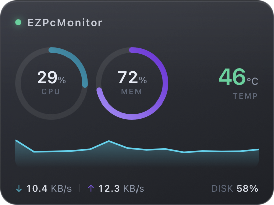
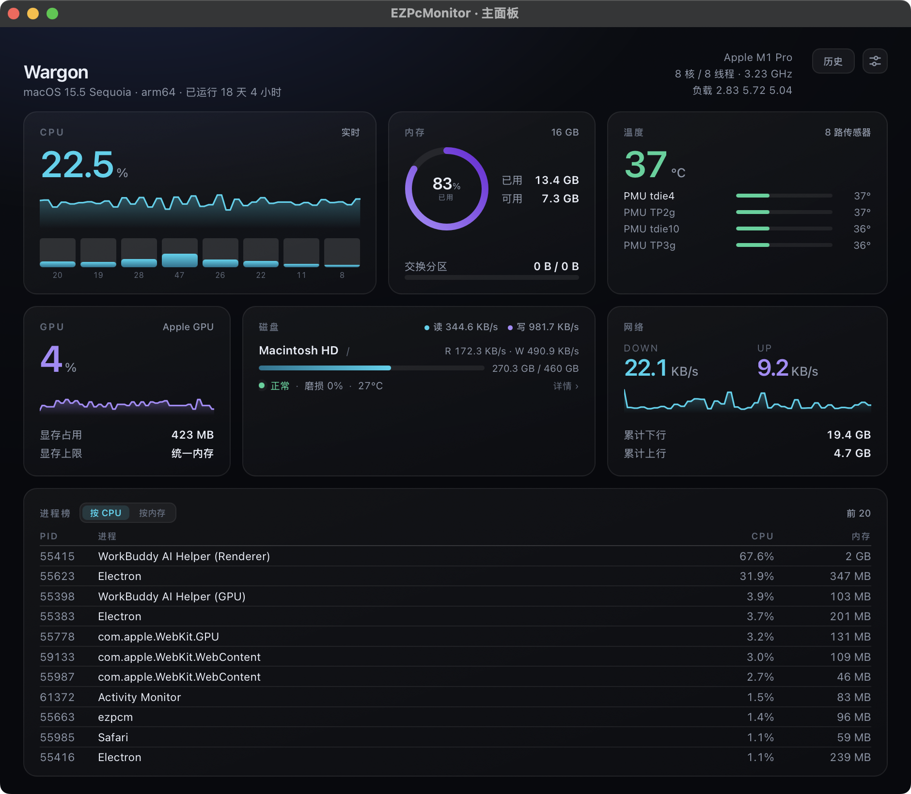
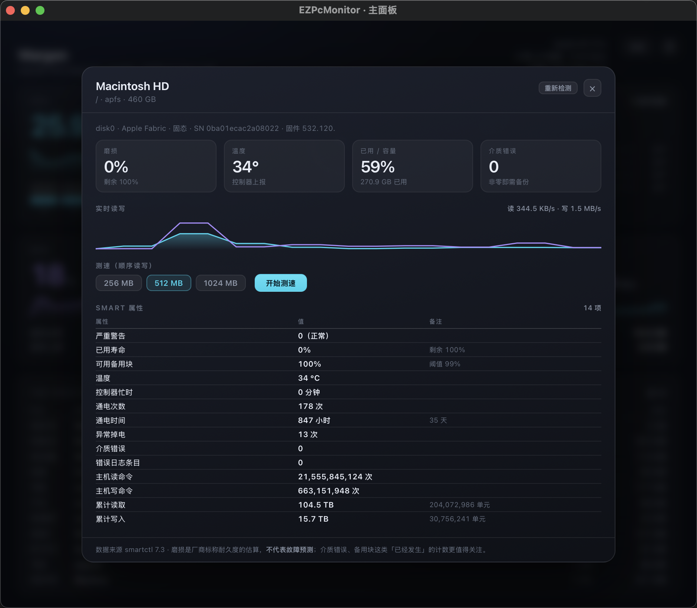
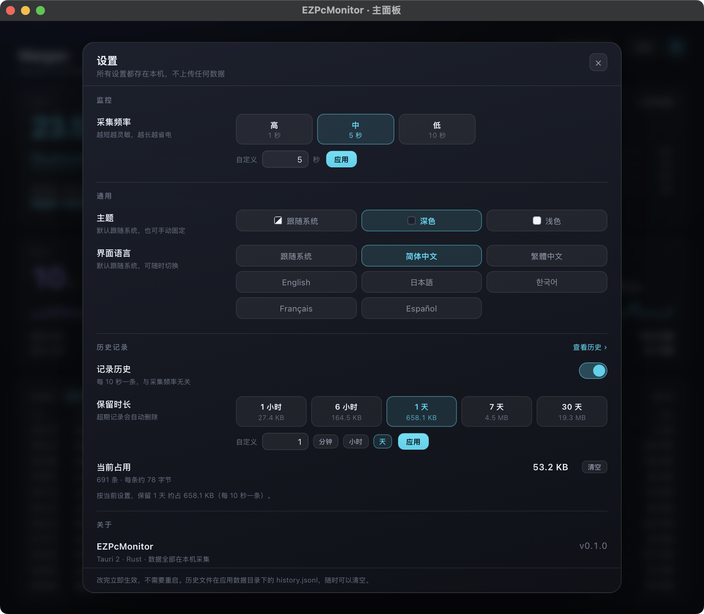
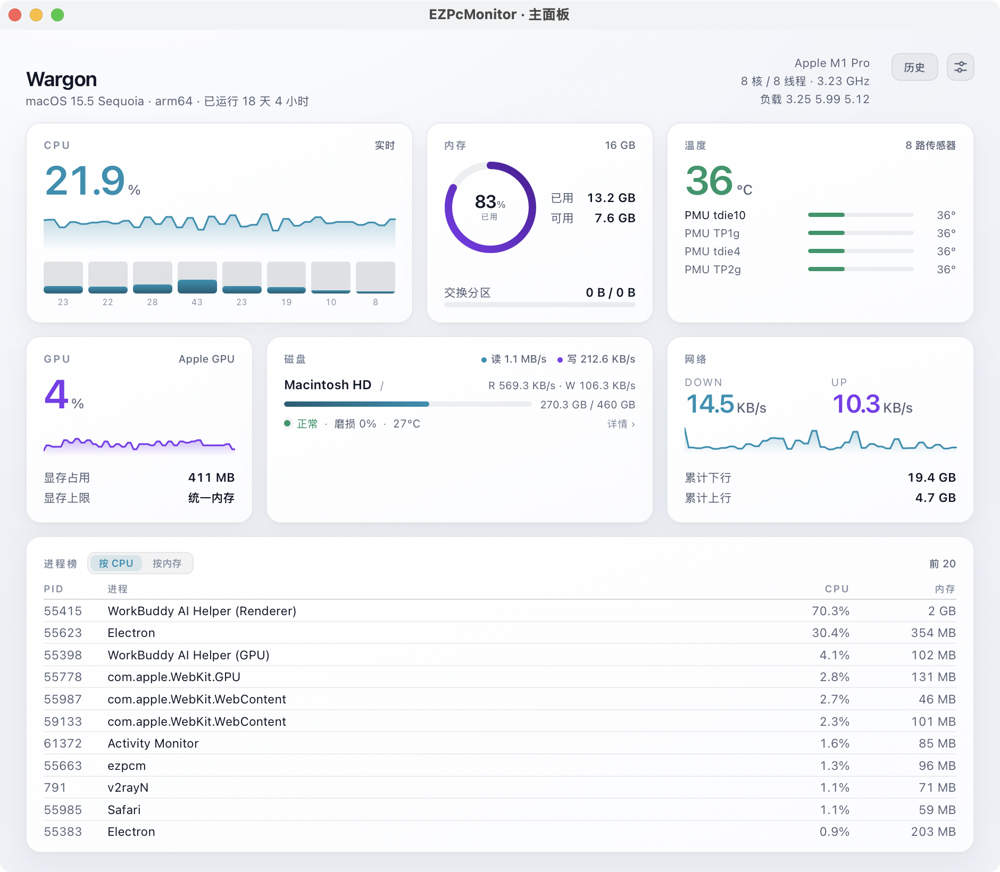
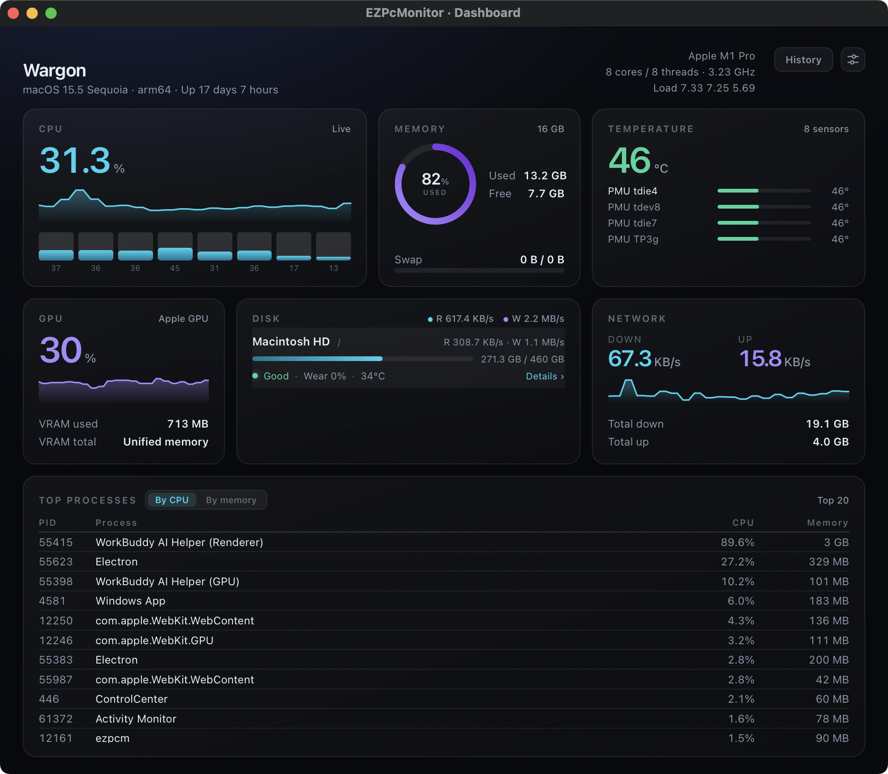
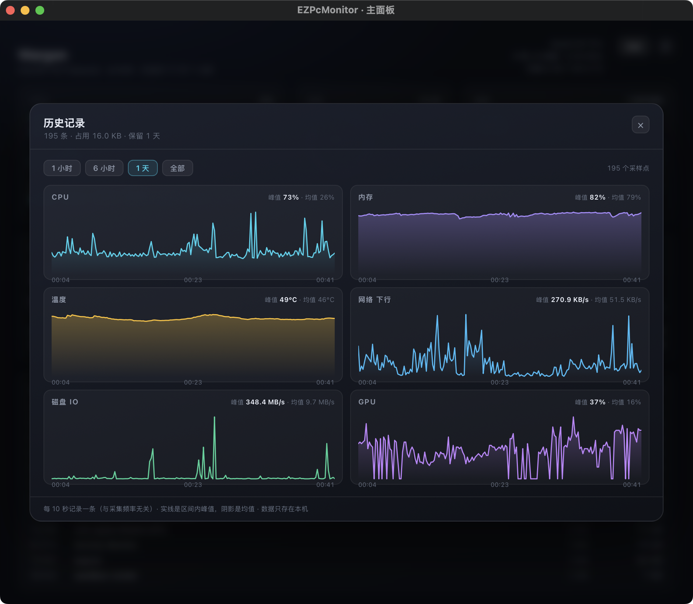

# EZPcMonitor

跨平台轻量级 PC 硬件监控 · 半透明悬浮窗

监控 **CPU / 内存 / 磁盘 / 网络 / 温度**，用一块毛玻璃悬浮窗常驻桌面，双击展开完整主面板。

<p align="center">
  
</p>

<p align="center">
  
</p>

## 为什么不用 Electron

| | Electron | **EZPcMonitor (Tauri 2)** |
|---|---|---|
| 安装包 | 90–150 MB | **3.4 MB** |
| 主进程内存 | 150–300 MB | **71 MB** |
| 常驻 CPU | 3–8% | **2.4% 单核** |
| 温度采集 | 需要 native 插件 | Rust 直连 IOKit / WMI / sysfs |

一个监控软件如果自己就吃掉 300MB 内存，那它监控什么呢。

## 特性

- **真·半透明**：macOS 用 `NSVisualEffectView`、Windows 用 Acrylic，是操作系统级毛玻璃，不是 CSS 假模糊
- **两种形态**：卡片（双环 + 温度 + 趋势）/ 紧凑条（单行）。条模式右键会把整条换成操作按钮，双击展开回卡片
- **主面板与悬浮窗互斥**：打开面板自动收起悬浮窗，关掉面板再放回来，桌面上不会同时挂两个窗口
- **托盘全控**：形态切换（卡片 / 紧凑条 / 显示隐藏）和不透明度（100/90/80/70/60%）都在菜单里点，偏好下次启动还记得
- **采集频率可调**：高（1 秒）/ 中（5 秒）/ 低（10 秒）三档 + 自定义（0.5–60 秒），托盘菜单和主面板齿轮都能改，改完当拍生效并记住
- **历史可回溯**：开启后每 10 秒记一条，保留 1 小时到 30 天（或自定义），点「历史」就能看过去六项指标的曲线和峰值。**默认关闭**，写不写盘你说了算
- **设置弹窗**：监控 / 通用 / 历史记录 / 关于分组，齿轮和托盘「设置…」进的是同一个地方
- **深色 / 浅色两套配色**：默认跟随系统，也可以手动固定；连原生标题栏一起切，浅色不是「把深色调亮」，是重新配的一版
- **七种界面语言**：简体中文 / 繁體中文 / English / 日本語 / 한국어 / Français / Español，默认跟随系统语言，设置里随时切换，**不用重启**——托盘菜单和窗口标题跟着一起变
- **GPU 独立成卡**：利用率曲线 + 显存占用，和磁盘并列在第二行
- **不挡操作**：一键鼠标穿透，全屏游戏里也安全
- **硬盘工具**：容量、实时读写、健康状态一眼可见；点开二级页看完整 SMART 属性表、实时曲线，还能做顺序读写测速。**`smartctl` 随包自带**，不用另装
- **按需采集**：悬浮窗只采必要指标，进程列表仅主面板可见时采集
- **零网络**：没有遥测、不联网；除设置文件外不写盘，历史记录需要你手动开启

## 快速开始

```bash
# 依赖：Node 20+ / Rust 1.80+
npm install
npm run tauri dev        # 开发模式（热更新）
npm run tauri build      # 生产构建
```

产物位置：`src-tauri/target/release/bundle/`

## 项目结构

```
├── index.html              主面板入口
├── widget.html             悬浮窗入口
├── src/
│   ├── main.tsx            主面板（每核负载 / 传感器 / 磁盘 / 进程）
│   ├── widget.tsx          悬浮窗
│   ├── components/Charts.tsx   Ring · Sparkline · Meter
│   ├── components/DiskStatus.tsx  一级页面的状态摘要
│   ├── components/DiskDetail.tsx  二级详情弹窗（属性表 / 曲线 / 测速）
│   ├── components/SettingsModal.tsx  设置弹窗（监控 / 通用 / 历史 / 关于）
│   ├── components/HistoryModal.tsx   历史回溯（时间窗 + 多指标曲线）
│   ├── i18n/               七份字典 + 查表/插值/单复数
│   ├── lib/theme.ts        深色/浅色 store（写 data-theme，auto 跟系统）
│   └── lib/                类型 / 事件订阅 / 格式化
├── src-tauri/
│   └── src/
│       ├── lib.rs          Tauri 装配 · 命令 · 托盘
│       ├── metrics.rs      采集内核
│       ├── diskhealth.rs   硬盘健康（diskutil + smartctl）
│       ├── bench.rs        顺序读写测速
│       ├── settings.rs     本地设置持久化
│       ├── i18n.rs         原生侧文案（托盘 / 窗口标题 / SMART 属性名）
│       ├── history.rs      历史记录（JSONL + 按保留时长修剪）
│       └── gpu.rs          GPU provider
└── docs/DESIGN.md          完整技术方案
```

## 平台支持

| 指标 | macOS | Windows | Linux |
|---|---|---|---|
| CPU / 内存 | ✅ | ✅ | ✅ |
| 磁盘容量 + IO | ✅ | ✅ | ✅ |
| 磁盘测速（顺序读写） | ✅ | ✅ | ✅ |
| 网络 | ✅ | ✅ | ✅ |
| 温度 | ✅ 无需 root | ⚠️ 需管理员（v1 接 LHM） | ✅ 无需 root |
| GPU 利用率 | ✅ | ⏳ v1 | ✅ amdgpu |
| 硬盘健康 / 寿命 | ✅ 自带 smartctl，免安装 | ⏳ v1 | ✅ 自带 / 系统包 |

## 硬盘工具

一级页面（首页磁盘卡）只放一眼能看懂的东西：容量、实时读写、一行状态。**复杂信息全部收进二级弹窗**——
点磁盘行打开，里面有完整属性表、实时读写曲线和顺序读写测速。

<p align="center">
  
</p>

数据分三层，能拿到多少报多少：

| 层 | 依赖 | 能拿到 |
|---|---|---|
| 系统级 | 无（macOS `diskutil`） | 健康状态 Verified / Failing、固态还是机械、总线类型 |
| 完整 SMART | **随包自带的 `smartctl`** | 磨损百分比、可用备用块、累计读/写量、通电时间与次数、介质错误、异常掉电、完整属性表 |
| 降级 | — | 拿不到的字段直接不显示，**不用估算值冒充实测** |

`smartctl` 已经打进 App 里（`Contents/Resources/resources/bin/`），用户不需要装任何东西；
系统里装了更新的版本会优先用自带的，跑不起来（比如架构不匹配）则自动回落到系统版本。
外置 USB 硬盘盒常见不支持 SMART 直通，这种情况会显示系统给的状态并说明原因，而不是报错。

**关于「寿命」的措辞**：界面写的是「磨损」而不是「剩余寿命」。`percentage_used` 是厂商标称
耐久度的磨损记账，**不是故障预测**——盘可能在磨损 0% 时猝死，也可能磨损 80% 还活得好好的。
所以详情页把「介质错误」这类**已经发生**的计数摆在磨损旁边，并明确写了这句提醒。

**测速**只做顺序读/写各一次（256 / 512 / 1024 MB 可选），写前 `fsync`、读时绕开 page cache，
测完自动删除临时文件。不做 4K 随机——那是跑分软件的事，日常监控用不上，还多消耗 SSD 寿命。

## 设置

主面板右上角齿轮，或托盘菜单 → `设置…`，打开的是同一个弹窗。按功能分组：

<p align="center">
  
</p>

**监控**：采集频率高（1 秒）/ 中（5 秒）/ 低（10 秒），也可以填 0.5–60 秒的任意值。
托盘菜单里也有同样的三档，两处改的是同一份状态。

改动**当拍生效**：采集线程每轮现读一次间隔，不等当前 sleep 走完。频率存在本地
`settings.json`，下次启动还是这个值。两个入口改的是同一个状态——托盘改完，主面板里的
「当前 X 秒」会立刻跟着变。

内部还有一层更慢的分级（磁盘 IO 2s / 温度 5s / 容量 30s），判断依据是**时间戳**而不是
「第几拍」，所以把主频率调到 10 秒，温度不会变成 50 秒才刷新——它跟着主拍走，只是每拍
检查一次该不该刷新。

## 主题

深色是原版，浅色是另配的一版——不是把深色反相，而是重新定了一遍：卡片改白底加淡投影、
正文用墨蓝而不是纯黑、图表曲线统一压深一档（1.6px 的线在白底上会被冲掉）。

<p align="center">
  
</p>

设置 → 通用 → 主题：**跟随系统** / **深色** / **浅色**。跟随系统时会跟着 macOS 的
外观切换实时变，不用重启；手动固定后就不再管系统怎么设。

切换连**原生标题栏**一起走（`app.set_theme`）——只改网页的话，浅色界面上会顶一条深色标题栏。
整套界面只有一份样式表：五十多处半透明面板统一用 `rgba(var(--ovl), α)`，
深色下 `--ovl` 是白色（提亮），浅色下是墨蓝（压暗），同一个 α 两边都成立。

## 语言

简体中文 / 繁體中文 / English / 日本語 / 한국어 / Français / Español 七种，**默认跟随系统语言**，
设置 → 通用 → 界面语言里随时切换。

<p align="center">
  
</p>

切换**立即生效，不用重启**：主面板、悬浮窗、三个弹窗、托盘菜单、窗口标题一起变。
没有引 i18n 库——只需要查表、插值和单复数，`zh-CN.ts` 是唯一基准，其余六份的类型由它推导，
**少翻一条键 `tsc` 就报错**。

托盘菜单是系统绘制的，拿不到网页里的翻译，所以原生侧另有一份（`src-tauri/src/i18n.rs`），
有单元测试保证七种语言覆盖所有条目。

两处例外，都是刻意的：**SMART 属性名**在非中文下用英文（`Percentage Used`、`Available Spare`
——smartctl / CrystalDiskInfo 里本来就这么写，硬翻反而对不上号）；**容量单位**统一按
SI 记号（KB / MB / GB）显示。

## 历史记录

「刚才是谁把 CPU 吃满了？」——这个问题实时曲线答不了，得能往回看。

**默认关闭**。开启后每 10 秒记一条（和采集频率无关，1 秒刷新也不会把文件撑大），
保留时长可选：

| 保留 | 预计占用 |
|---|---|
| 1 小时 | 约 30 KB |
| 6 小时 | 约 180 KB |
| 24 小时 | 约 710 KB |
| 7 天 | 约 4.8 MB |
| 30 天 | 约 21 MB |

<p align="center">
  
</p>

点主面板右上角「历史」，切时间窗看 CPU / 内存 / 温度 / 网络 / 磁盘 IO / GPU 六项曲线。
实线是**区间内峰值**、阴影是**均值**——只画均值会把「飙到 100% 的那十秒」平均掉。

数据是 `history.jsonl`（一行一条，约 85 字节），只追加；修剪时整文件重写一次并用
`rename` 原子替换，掉电不会留下半截文件。文件在应用数据目录，设置里能看到实时占用，
也能一键清空。

## 性能

实测环境：macOS 15.5 / Apple M1 Pro / Release 构建

| 指标 | 实测 |
|---|---|
| 安装包（.app） | **4.12 MB**（含自带的 705 KB smartctl） |
| 主进程 RSS | 71 MB |
| 全进程合计 RSS | 166 MB（含 3 个 WebKit 辅助进程） |
| 常驻 CPU | **2.4% 单核**（≈0.3% 整机） |
| 前端产物 | 157 KB JS / 7.6 KB CSS（gzip 56 KB） |

采集间隔默认 1s（可在托盘或主面板改成 5s / 10s / 自定义），内部再按耗时分级：
磁盘 IO 2s（仅主面板打开时）· 温度 5s · 磁盘容量 30s。分级用的是**时间戳**而不是
「第几拍」，所以改频率不会把温度、容量的刷新节奏带歪。
`cargo run --release --example bench` 可复现采集内核的基准数据。

## 文档

完整技术方案（选型对比、采集矩阵、权限模型、悬浮窗规范、路线图）见 [docs/DESIGN.md](docs/DESIGN.md)。

**改动架构前请先读 [docs/DECISIONS.md](docs/DECISIONS.md)**——那里记着已经拍板的结论和理由
（比如为什么叫「磨损」不叫「寿命」、为什么不做 NAND 材质、为什么先自带 smartctl 再写原生实现、
为什么采集频率要放在 Rust 侧而不是前端）。

## License

MIT
