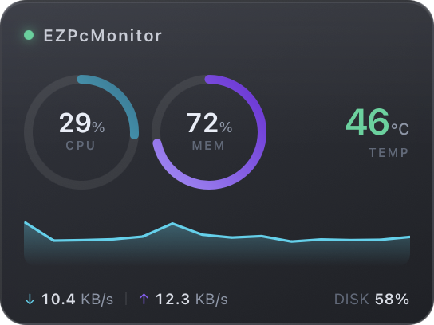
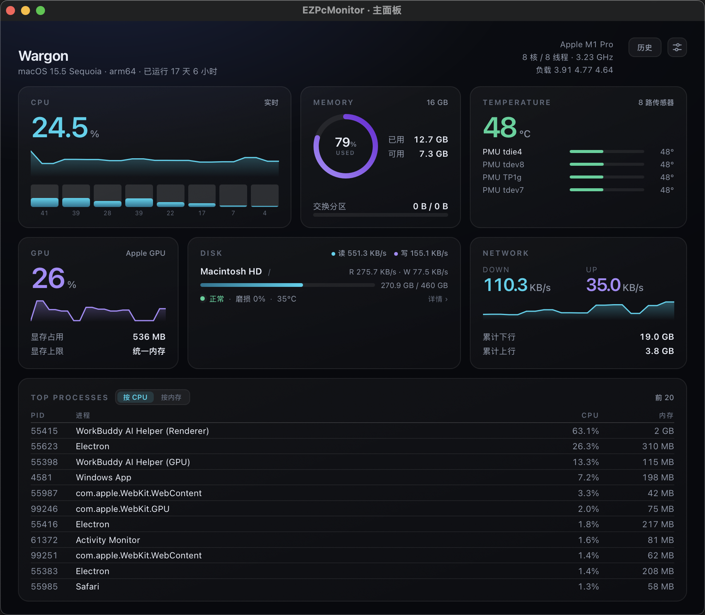

# EZPcMonitor 技术方案

> 跨平台轻量级 PC 硬件监控 · 半透明悬浮窗 · CPU / 内存 / 磁盘 / 网络 / 温度
>
> 版本 v0.1 · 2026-10

> **这份文档写的是 v0.1（Tauri 2 + React + WebView）那一版。**
> v0.2 把外壳换成了 AppKit / SwiftUI（`macos/`），采集内核原样留在 `core/`，
> 中间隔一层 C ABI。所以下面提到 `src/`、`src-tauri/`、`vite.config.ts` 的地方
> 都属于历史——那些目录已经不在这个分支上了（`master` / `mac_original` 里还在）。
> 原生版的结构与实测数据看 [README](../README.md)；每个"为什么这么写"都记在对应源文件的注释里。





---

## 1. 产品定位

**一句话**：一个常驻后台、占用不到 1% CPU、用一块毛玻璃悬浮窗把机器状态说清楚的监控工具。

### 1.1 目标用户

| 人群 | 场景 | 核心诉求 |
|---|---|---|
| 开发者 | 跑编译、跑容器、跑本地模型 | 随时知道 CPU/内存/温度是否顶到墙 |
| 游戏 / 剪辑用户 | 全屏应用下看负载 | 悬浮窗不能被遮挡、不能抢焦点 |
| IT / 运维 | 批量机器巡检 | 轻量、可静默部署、无遥测 |

### 1.2 设计原则

1. **轻**：不为了好看牺牲开销。Electron 那一套（150MB+ 内存）直接排除。
2. **准**：宁可显示 `N/A`，也不显示编造的数字。温度拿不到就说拿不到，并给出获取路径。
3. **静**：默认零网络、零落盘、零弹窗。启动后只有一块玻璃。

### 1.3 性能预算（硬指标）

| 指标 | 目标 | 红线 |
|---|---|---|
| 常驻内存 (RSS) | ≤ 80 MB | 120 MB |
| 空闲 CPU | ≤ 0.5% | 1.5% |
| 安装包 | ≤ 12 MB | 25 MB |
| 冷启动到首帧 | ≤ 400 ms | 800 ms |
| 磁盘写入 | 0（不写日志） | 仅配置 |

### 1.4 性能不是猜出来的，是量出来的

这一版做过一轮完整的 profiling（`cargo run --release --example bench`），结论和直觉完全相反：

| 子系统 | 单次耗时 | 直觉判断 | 实际 |
|---|---|---|---|
| CPU 使用率 | 0.06 ms | 贵 | 极便宜 |
| 内存 | 0.04 ms | 贵 | 极便宜 |
| 网络 | 1.0 ms | 中等 | 便宜 |
| 磁盘 IO 统计 | 3.6 ms | 贵 | 便宜 |
| **磁盘容量枚举** | **51 ms** | 便宜 | **很贵** |
| **温度（IOHID）** | **74 ms** | 中等 | **最贵** |
| 进程列表 | 17 ms | 很贵 | 中等 |

两个反直觉的点直接决定了架构：

1. **磁盘容量比磁盘 IO 贵 15 倍。** `statfs` 要对每个挂载点走一次文件系统，而 APFS 会挂出 `/System/Volumes/*` 一大堆。所以容量 30s 一次，IO 只在主面板打开时 2s 一次。
2. **温度是最贵的一项，但它是慢变量。** 74ms 换一个 5 秒内不会变的值不值得，改成 5s 一次。

优化后合成一帧从 **50.7ms 降到 13.8ms**（悬浮窗模式），降幅 73%。

另外三条「省电」经验，都是实测出来的：

- **不要用无限循环 CSS 动画。** 一个 `animation: breathe 2.6s infinite` 的状态灯，会让 CoreAnimation 的 CVDisplayLink 常驻 60fps，白白耗电。静态 `box-shadow` 效果一样。
- **不要提前创建不用的 WebView。** 主面板的 WebView 常驻要多吃 50MB 内存 + 一个 WebContent 进程，改成按需创建。
- **系统已经做了模糊，就别再用 CSS `backdrop-filter`。** 两套模糊叠加，等于让合成器多跑一遍离屏渲染。

---

## 2. 技术选型

### 2.1 候选方案对比

| 方案 | 包体积 | 常驻内存 | 温度采集 | UI 表现力 | 结论 |
|---|---|---|---|---|---|
| Electron + React | 90–150 MB | 150–300 MB | 需 native 插件 | ★★★★★ | ❌ 太重，违背产品定位 |
| **Tauri 2 + Rust + Web 前端** | **8–15 MB** | **60–90 MB** | **Rust 直接调系统 API** | ★★★★☆ | ✅ **采用** |
| Wails (Go) | 10–20 MB | 70–100 MB | Go 生态弱 | ★★★★☆ | ⚪ 备选，温度库不成熟 |
| Flutter Desktop | 20–40 MB | 90–150 MB | 插件稀缺 | ★★★★★ | ⚪ 渲染好，但系统层薄 |
| Qt / QML (C++) | 25–60 MB | 60–120 MB | 最成熟 | ★★★☆☆ | ⚪ 授权与打包复杂 |
| 纯原生三套 UI | 5–10 MB | 30–60 MB | 最成熟 | ★★★★☆ | ❌ 三倍工作量，放弃 |

### 2.2 为什么是 Tauri 2

- **复用系统 WebView**：macOS 用 WKWebView，Windows 用 WebView2，Linux 用 WebKitGTK。运行时不需要打包浏览器内核，这是体积差的根源。
- **Rust 侧能直接摸到系统层**：读 IOKit、调 Win32、解析 `/sys`，不需要写 native 插件桥。
- **渲染能力足够**：悬浮窗要的是渐变、圆角、模糊、动画，Web 技术栈是最省力的选择。
- **代价**：各平台 WebView 版本不一致（尤其 Linux WebKitGTK 的老版本），需要限制 CSS 特性；已在 `vite.config.ts` 里把构建目标设为 `safari15` 兜底。

### 2.3 采集库选型

`sysinfo`（0.39）一个 crate 覆盖 CPU / 内存 / 磁盘 / 网络 / 温度 / 进程，跨三平台，且**温度在 Apple Silicon 上走 IOHIDEventSystemClient**（`kHIDPage_AppleVendor` + `kHIDUsage_AppleVendor_TemperatureSensor`），**不需要 root**——这是选它的关键原因。

平台特有的、sysinfo 覆盖不到的（风扇转速、Windows 深度传感器、NVIDIA GPU）走独立 provider，见 §4.2。

---

## 3. 系统架构

```
┌──────────────────────────────────────────────────────────────┐
│  呈现层 (WebView)                                             │
│  ┌────────────────┐  ┌────────────────┐  ┌────────────────┐  │
│  │ widget.html    │  │ index.html     │  │ 托盘菜单        │  │
│  │ 半透明悬浮窗    │  │ 主面板          │  │ (Rust 原生)    │  │
│  └───────┬────────┘  └───────┬────────┘  └────────────────┘  │
└──────────┼───────────────────┼───────────────────────────────┘
           │  event: metrics:tick (push, 1Hz)
           │  invoke: get_snapshot / set_widget_mode / ...
┌──────────┴───────────────────┴───────────────────────────────┐
│  状态层 (Rust)                                                │
│   AppState { snapshot: Mutex<Snapshot>, history: RingBuffer } │
└──────────────────────────┬───────────────────────────────────┘
                           │
┌──────────────────────────┴───────────────────────────────────┐
│  采集层 (单线程, 固定节拍)                                     │
│   ┌────────────┬────────────┬────────────┬────────────┐      │
│   │ CPU  1s    │ MEM  1s    │ DISK IO 2s*│ TEMP 5s    │      │
│   ├────────────┼────────────┼────────────┼────────────┤      │
│   │ NET  1s    │ PROC 3s*   │ GPU  10s†  │ CAP  30s   │      │
│   └────────────┴────────────┴────────────┴────────────┘      │
│   * 仅主面板可见时采集   † 独立线程，慢查询隔离                │
└──────────────────────────────────────────────────────────────┘
                           │
┌──────────────────────────┴───────────────────────────────────┐
│  平台抽象 (sysinfo + 自研 provider)                            │
│   Windows: PDH / WMI / NVML    macOS: IOKit / IOHID / SMC     │
│   Linux: /proc / /sys/class/hwmon                             │
└──────────────────────────────────────────────────────────────┘
```

### 3.1 三个关键决策

**① 单线程串行采集，而不是每类指标一个线程。**
`/proc`、IOKit、WMI 的调用本身就有锁竞争，多线程只会让抖动叠加，还会让 CPU 占用出现尖刺。串行 + 固定节拍（`run_loop` 用绝对时间对齐，不累积 `sleep` 漂移）更稳。

**② 事件推送，而不是前端轮询。**
Rust 采完一帧直接 `emit("metrics:tick")`，前端 `listen` 即可。前端没有 `setInterval`，窗口隐藏时浏览器会自动节流渲染，开销趋近于 0。

**③ 按需采集进程列表。**
遍历全系统进程在 macOS 上要几十毫秒。悬浮窗不需要进程数据，所以默认关闭，主面板挂载时 `set_want_procs(true)`，卸载时关掉。

### 3.2 数据流

```
sysinfo.tick() → Snapshot → ① 写入 AppState（供 get_snapshot 冷启动）
                           → ② 追加 HistoryPoint（300 点环形缓冲 = 5 分钟）
                           → ③ emit 到所有 WebView
```

前端持有自己的短窗缓冲（72 点）画迷你图，长窗数据走 `get_history(seconds)` 按需拉取，避免每秒传大数组。

---

## 4. 指标采集矩阵

这是整个项目最容易踩坑的地方，逐项列清楚「用什么 API、要不要权限、多久采一次」。

### 4.1 核心指标

下表的「频率」是最慢刷新档位；CPU / 内存 / 网络跟着**主采集间隔**走（默认 1s，
用户可改成 0.5–60s，见 ADR-010），其余按时间戳独立分级，与主间隔解耦。

| 指标 | Windows | macOS | Linux | 权限 | 频率 |
|---|---|---|---|---|---|
| CPU 使用率 | `NtQuerySystemInformation(SystemProcessorPerformanceInformation)` | `host_processor_info(PROCESSOR_CPU_LOAD_INFO)` | `/proc/stat` | 无 | 主间隔 |
| CPU 频率 | `CallNtPowerInformation` | `sysctl hw.cpufrequency`（Intel）/ IOReport（AS） | `/sys/devices/system/cpu/cpu*/cpufreq` | 无 | 5s |
| 内存 | `GlobalMemoryStatusEx` | `host_statistics64` + `sysctl hw.memsize` | `/proc/meminfo` | 无 | 主间隔 |
| 磁盘容量 | `GetDiskFreeSpaceExW` | `statfs` | `statvfs` | 无 | 30s |
| 磁盘 IO | PDH `\PhysicalDisk(_Total)\Disk Read Bytes/sec` | IOKit `IOBlockStorageDriver` Statistics | `/proc/diskstats` | 无 | 2s |
| 网络 | `GetIfTable2` | `getifaddrs` + `if_data.ifi_ibytes` | `/proc/net/dev` | 无 | 主间隔 |
| 进程 | `NtQuerySystemInformation` + `OpenProcess` | `proc_pidinfo(PROC_PIDTASKINFO)` | `/proc/<pid>/stat` | 部分需 root | 3s |

### 4.2 温度：三平台三条完全不同的路

温度是这类软件的分水岭，也是权限模型的分水岭。

#### macOS

| 芯片 | 方案 | 权限 | 可靠性 |
|---|---|---|---|
| Apple Silicon (M1–M4) | `IOHIDEventSystemClient` 匹配 `kHIDPage_AppleVendor / kHIDUsage_AppleVendor_TemperatureSensor`，用 `IOHIDEventGetFloatValue(kIOHIDEventTypeTemperature)` 读数 | **无需 root** | ★★★★★ |
| Intel Mac | AppleSMC IOKit，读 `TC0P`/`TC0D`/`TC0E` 等 key | **无需 root** | ★★★★☆ |
| 兜底 | `powermetrics --samplers smc` | **需要 root** | ★★★★☆ 但太重 |

`sysinfo` 已经把前两条实现了（`src/unix/apple/macos/component/{arm,x86}.rs`），所以本项目在 macOS 上开箱即得，这是选型时验证过的关键点。

> 注意：Apple Silicon 会返回十几路传感器，其中 `gas gauge battery` 是电池温度、`NAND CH0 temp` 是闪存温度。**不能简单取最大值**，否则满载时显示的是电池发烫。本项目用标签打分（`score_label`）挑主传感器：`tdie` +120、`cpu` +100、`soc/package` +90，`battery/gas gauge` −200、`gpu` −80、`nand/ssd` −60。

#### Windows

| 层级 | 方案 | 权限 | 覆盖度 |
|---|---|---|---|
| L1 尽力而为 | WMI `root\WMI:MSAcpi_ThermalZoneTemperature` | 普通用户可读 | 大量主板不实现，或只返回机箱/环境温度 |
| L2 推荐 | 内置 **LibreHardwareMonitorLib** sidecar（.NET 8 AOT 单文件），通过 MSR 读 CPU DTS、SMBus 读主板、SMART 读 NVMe | **管理员** | ★★★★★ 接近 HWiNFO |
| L3 自研 | 直接 `WinRing0` 读 MSR `0x1A2` (IA32_PACKAGE_THERM_STATUS) | **管理员 + 内核驱动** | ★★★★☆ 但驱动签名/杀软误报成本高 |

**决策**：MVP 走 L1（拿不到就显示 `N/A` + 引导），v1 引入 L2 sidecar。理由：L3 会让一个监控软件变成杀毒软件的重点关照对象，不值得。

#### Linux

```
/sys/class/hwmon/hwmon*/temp*_input   (coretemp / k10temp / nvme / amdgpu)
/sys/class/thermal/thermal_zone*/temp
```
纯文件读取，**无需 root**，覆盖度最好。这也是三平台里唯一「零成本」的。

### 4.3 GPU / 风扇（v1 范围）

| 指标 | Windows | macOS | Linux |
|---|---|---|---|
| GPU 利用率 | NVML（N 卡）/ D3DKMT（A/I 卡） | `ioreg -c IOAccelerator` 解析 `Device Utilization %` | `/sys/class/drm/card*/device/gpu_busy_percent` |
| 显存 | NVML | `In use system memory` | `mem_info_vram_used` |
| 风扇转速 | LHM sidecar | SMC `F0Ac` | `hwmon/fan*_input` |

macOS 的 `ioreg` 方案已在本项目实现并验证可用（Apple M 系列返回 `Device Utilization %`），因为它是子进程调用，所以放在独立线程、5s 一次，绝不阻塞主循环。

### 4.4 硬盘健康（SMART）

磁盘容量只是"用了多少"，用户真正关心的是"还能用多久"。SMART 数据没有统一 API，只能分层拿：

| 层 | 手段 | 权限 | 能拿到 |
|---|---|---|---|
| L1 系统级 | macOS `diskutil info <mount>` | 无 | `SMART Status: Verified/Failing`、固态/机械、总线协议 |
| L2 完整 | `smartctl -x -j <dev>`（**随包自带**，见 ADR-005） | macOS 无（Apple SSD 走 IOKit）；Linux 需 root 或 udev 规则 | `percentage_used`（磨损）、`available_spare`、`data_units_written/read`、`power_on_hours`、`media_errors`、`unsafe_shutdowns`、`critical_warning`、完整属性表 |
| L3 兜底 | Windows：LHM sidecar（v1） | 管理员 | 同 L2 |

三个必须处理的坑：

1. **挂载点 ≠ 物理盘**。APFS 的 `/` 实际是合成卷 `disk3s1s1`，SMART 要问底下的 `disk0`。`diskutil info` 的 `APFS Physical Store` 字段直接给出答案，比自己拼 `diskXsY` 可靠。
2. **smartctl 退出码是位掩码**，非 0 不代表读取失败（例如"历史错误记录"也会置位）。只按 stdout 能否解析成 JSON 判断成败。
3. **外置 USB 硬盘盒多数不支持 SMART 直通**。这不是错误而是硬件限制，UI 上要说明原因，而不是弹一个失败。

成本：`diskutil` ~40ms、`smartctl` ~30ms，都是 fork 子进程。因此只在主面板可见时按需触发，结果缓存 60s，整次探测带 3s 硬超时（放到子线程 + `recv_timeout`），坏盘掉线也不会卡住界面。

单位口径：NVMe 的 `data_units_written` 一个单位 = 1000 × 512 字节，展示时按**十进制**换算，才能和厂商标称的 TBW、`smartctl` 自己打印的 `[15.7 TB]` 对上。

---

## 5. 权限与降级模型

**核心原则：默认零权限可用，深度数据按需授权，任何情况下不静默提权。**

| 能力级 | 内容 | 权限 | 默认 |
|---|---|---|---|
| **Basic** | CPU / 内存 / 磁盘容量与 IO / 网络 / 进程 | 无 | ✅ 开启 |
| **Tool** | 硬盘 SMART 明细（调用可选安装的 `smartctl`） | 无（工具本身不需要） | ✅ 装了就用，没装降级到系统级状态 |
| **Sensor** | CPU 温度、风扇、电压 | 管理员/root | ⬜ 用户主动开启 |
| **Driver** | 内核驱动级传感器（WinRing0 等） | 管理员 + 驱动 | ❌ 不提供 |

### 5.1 各平台提权路径

| 平台 | 方案 | 优点 | 缺点 |
|---|---|---|---|
| Windows | 用户手动「以管理员身份运行」 | 简单透明 | 每次启动要确认 |
| Windows | 注册为 Windows 服务（`sc create`），UI 以普通权限连本地 IPC | 一次授权长期有效 | 安装复杂度上升，需签名 |
| Windows | 计划任务 + `HighestAvailable` | 无需服务 | 首次需 UAC |
| macOS | 普通用户运行（本项目默认路径，SMC/IOHID 不需要 root） | 零摩擦 | `powermetrics` 类数据拿不到 |
| macOS | 安装 LaunchDaemon，仅暴露本地 socket | 可拿全部数据 | 需签名 + 公证，用户信任成本高 |
| Linux | `udev` 规则给 `/dev/cpu/*/msr` 加组权限 | 干净 | 需 root 一次性配置 |

### 5.2 UI 降级表现

拿不到数据时**不隐藏卡片**，而是显示 `--` 并在卡片角标给出可点击的「如何获取」。让用户知道"这不是坏了，是权限不够"，比默默少一块更专业。

---

## 6. 悬浮窗设计（重点）

### 6.1 视觉规范

| 项 | 值 | 说明 |
|---|---|---|
| 卡片尺寸 | 272 × 238 | 内容区 260 × 226（四周留 6px 给阴影） |
| 紧凑条 | 300 × 46 | 单行，5 段信息 |
| 圆角 | 16px / 13px | 卡片 / 紧凑条 |
| 背景 | `linear-gradient(158deg, rgba(24,29,42,.74), rgba(10,12,18,.82))` | 深色玻璃，保证任何壁纸上文字都可读 |
| 描边 | `1px rgba(255,255,255,.10)` + 内高光 | 玻璃的"厚度" |
| 模糊 | 系统级毛玻璃 + CSS `backdrop-filter` 兜底 | 见 6.2 |
| 阴影 | `0 14px 34px -10px rgba(0,0,0,.65)` | 悬浮感 |

### 6.2 半透明怎么实现（这是本方案最关键的一处）

**普通 CSS `backdrop-filter` 在 Tauri 透明窗口里是"假模糊"**：它模糊的是 WebView 自己的合成层，背后是桌面，模糊不到。必须让操作系统来做。

| 平台 | 实现 | 代码 |
|---|---|---|
| macOS | `NSVisualEffectView`，material = `HudWindow`，state = `Active` | `window_vibrancy::apply_vibrancy(&win, HudWindow, Some(Active), Some(18.0))` |
| Windows 10/11 | Acrylic（`SetWindowCompositionAttribute`） | `window_vibrancy::apply_acrylic(&win, Some((16,18,26,170)))` |
| Linux | 无系统级 API，退化为 CSS `rgba` + `blur` | 文档说明 |

配置前提：`tauri.conf.json` 里 `transparent: true` + `shadow: false`（macOS 需要 `macOSPrivateApi: true`）。关掉系统阴影是因为它按矩形窗口计算，会把圆角"补"成方块。

### 6.3 交互

| 交互 | 行为 | 实现 |
|---|---|---|
| 拖拽 | 任意非按钮区域可拖 | `data-tauri-drag-region` |
| 双击 | 打开主面板 | `onDoubleClick → invoke("open_dashboard")` |
| 右键 | 自定义菜单（模式/置顶/穿透/主面板/退出） | HTML 菜单，避免原生菜单风格割裂 |
| 悬停 | 右上角按钮淡入（0.18s） | 不常驻，保持界面干净 |
| 点击穿透 | 窗口对鼠标透明，游戏里不挡操作 | `set_ignore_cursor_events(true)` |
| 置顶 | 默认开启，可关闭 | `setAlwaysOnTop` |
| 托盘 | 显示/隐藏、穿透开关、退出 | Rust `TrayIconBuilder` |

**点击穿透的陷阱**：开启后用户就点不到窗口了，必须有窗口外的出口。所以穿透开关**只放在托盘菜单**，并且托盘菜单项是 `CheckMenuItem`，能反映真实状态。

### 6.4 形态

1. **卡片（默认）**：双环 + 温度 + CPU 折线 + 网络/磁盘脚注。
2. **紧凑条**：`CPU 42% │ MEM 68% │ 51°C │ ↓1.2M ↑84K`，适合贴屏幕边缘。
3. **迷你环**（v1）：单环 + 温度，48×48。

### 6.5 信息优先级

悬浮窗只有 260px 宽，必须做减法：

1. **CPU / 内存** → 环形进度（一眼看比例，比数字快）
2. **温度** → 大字号数字（唯一的"绝对风险"指标，超 85°C 变红）
3. **趋势** → CPU 折线（判断是瞬时尖刺还是持续高负载）
4. **网络/磁盘** → 脚注小字（参考信息，不需要一眼看清）

---

## 7. 数据模型与 IPC 契约

### 7.1 Snapshot（`metrics:tick` 的 payload）

```json
{
  "ts": 1760793600123,
  "host": { "name": "mac", "os": "macOS 15.5", "kernel": "24.5.0", "arch": "aarch64", "appVersion": "0.1.0" },
  "cpu": { "usage": 12.4, "perCore": [8.1, 15.2, 3.4, 22.0], "brand": "Apple M3 Pro", "cores": 12, "physical": 12, "freqMhz": 0 },
  "mem": { "total": 38654705664, "used": 21000000000, "available": 17000000000, "swapTotal": 2147483648, "swapUsed": 0 },
  "disks": [{ "name": "Macintosh HD", "mount": "/", "fs": "apfs", "kind": "SSD", "total": 994662584320, "free": 400000000000, "used": 594662584320, "readBps": 0, "writeBps": 0, "removable": false }],
  "diskTotalReadBps": 0, "diskTotalWriteBps": 0,
  "net": { "rxBps": 12000, "txBps": 8400, "totalRx": 123456789, "totalTx": 98765432 },
  "temps": [{ "label": "PMU tdie0", "value": 51.2, "max": null, "critical": null, "primary": true }],
  "gpu": { "name": "Apple GPU", "utilization": 30, "memUsed": 516882432, "memTotal": null },
  "load": [2.1, 1.9, 1.7],
  "uptime": 86400,
  "procs": [{ "pid": 1234, "name": "Xcode", "cpu": 42.1, "mem": 1073741824 }]
}
```

### 7.2 命令表

| 命令 | 参数 | 返回 | 说明 |
|---|---|---|---|
| `get_snapshot` | — | `Snapshot` | 冷启动补一帧，避免等 1s |
| `get_history` | `seconds` | `HistoryPoint[]` | 长窗图表 |
| `set_want_procs` | `on: bool` | — | 按需采集进程 |
| `disk_health` | `force?: bool` | `DiskHealth[]` | 硬盘 SMART，60s 缓存，`force` 跳过缓存 |
| `disk_bench` | `mount, sizeMb?` | `BenchResult` | 顺序读写测速（async，几秒级 IO） |
| `get_settings` | — | `Settings` | 采集间隔 + 历史开关 + 保留时长 + 界面语言 + 主题 |
| `update_settings` | `patch` | `Settings` | 只传要改的项；夹取 → 落盘 → 广播 `settings:changed` → 刷新托盘 |
| `history_stats` | — | `HistoryStats` | 条数、占用、实测每条字节数、时间跨度、各档预设 |
| `history_range` | `from?: u64` | `Point[]` | 取历史点，缺省按保留时长 |
| `proc_leaders` | `from?: u64` | `Leaders` | 程序榜：按名字合并后的 CPU/内存/磁盘统计（async，要扫一遍分片） |
| `save_report` | `png: number[], name` | `string` | 报告图落下载目录，重名自动 `-2`、`-3`，返回绝对路径 |
| `copy_image` | `path` | — | 把已保存的 PNG 塞进系统剪贴板（仅 macOS，其它平台返回 `unsupported`） |
| `clear_history` | — | — | 删掉历史文件与 `procs/` 分片 |
| `get_locale` | — | `string` | 系统语言标签（`zh-CN` / `en` / …），仅供「跟随系统」显示 |
| `take_open_settings` | — | `bool` | 托盘点了「设置…」时，前端启动后取一次标记并清除 |
| `set_widget_mode` | `mode: "card"\|"bar"` | — | 同时调整窗口尺寸 |
| `set_click_through` | `on: bool` | `bool` | 鼠标穿透 |
| `toggle_widget` | — | `bool` | 显示/隐藏 |
| `open_dashboard` | — | — | 打开主面板 |
| `quit_app` | — | — | 退出 |

### 7.3 事件（Rust → 前端）

| 事件 | 目标 | payload | 说明 |
|---|---|---|---|
| `metrics:tick` | widget / main | `Snapshot` | 每拍一次；主面板不可见时不推 |
| `settings:changed` | 全部 | `Settings` | 任一设置变更，所有窗口一起同步 |
| `settings:open` | main | — | 托盘点了「设置…」，让设置弹窗展开 |

### 7.4 Settings 与多语言

`settings.json`（应用配置目录，本机、不上传）：

```json
{
  "intervalMs": 5000,
  "historyEnabled": true,
  "historyRetentionSecs": 86400,
  "language": "auto",
  "theme": "auto"
}
```

`language` 取 `auto` 或七个标签之一：`zh-CN` `zh-TW` `en` `ja` `ko` `fr` `es`。
`auto` 由后端解析成具体语言（`sys-locale`，`EZPCM_LANG` 可覆盖），
前端拿到的永远是解析后的结果，两边不会各算一次。

界面文案分两处，界限是「谁能渲染它」：

| 位置 | 内容 | 文件 |
|---|---|---|
| 前端 | 主面板 / 悬浮窗 / 三个弹窗的全部文案 | `src/i18n/*.ts`（七份字典） |
| 原生 | 托盘菜单、窗口标题、SMART 属性表 | `src-tauri/src/i18n.rs`（七张表） |

`zh-CN.ts` 是唯一基准，`Dict` 类型由它推导，其余六份标注 `const strings: Dict`：
少一条键就是编译错误。前端用 `useI18n()`（模块级 store + `useSyncExternalStore`，
不用 Context——主面板和悬浮窗是两个独立 React root），
数字和日期走 `Intl`，复数用 `[单数, 复数]` 二元组。

SMART 属性表刻意只做中英两种：`Percentage Used` 这类名字在 smartctl / CrystalDiskInfo
里本来就是英文，硬翻反而对不上号。语言变更时后端会清掉 `diskhealth` 的缓存，
否则会看到一门语言的界面配另一门语言的表格（缓存里存的是格式化好的字符串）。

### 7.5 主题

`theme` 取 `auto` / `dark` / `light`，与 `language` 同构：真值在 Rust，
前端镜像，`auto` 由前端监听 `prefers-color-scheme` 解析（WebView 的能力，
Rust 侧看不到它的变化）。

配色不用第二套样式表，而是**一组变量覆盖两次**：

| 变量 | 深色 | 浅色 | 用途 |
|---|---|---|---|
| `--ovl` | `255,255,255` | `16,24,40` | 所有半透明面板的叠加层基色 |
| `--text-rgb` | `232,237,247` | `16,24,40` | 半透明文字 |
| `--card-bg` | 白 4.5%→1.8% | `#fff` → `#fbfcfe` | 卡片底 |
| `--card-shadow` | `none` | 两层淡投影 | 白底靠投影分层 |
| `--page` | 深蓝径向渐变 | 白→淡蓝径向渐变 | 主面板背景 |
| `--scrim` | 黑 62% | 墨蓝 30% | 弹窗遮罩 |
| `--c-*` | 亮一档 | 深一档 | 图表曲线（1.6px 在白底会糊） |

`rgba(var(--ovl), α)` 的妙处是同一个 α 在两种主题下都成立——叠加方向反了过来，
深色是提亮、浅色是压暗。切换只改 `<html data-theme>`，不给组件传色值。

浅色值在 CSS 里出现两次（`:root[data-theme="light"]` 与
`@media (prefers-color-scheme: light)`），第二份只为**首帧**：
`get_settings` 回来之前页面上还没有 `data-theme`，否则浅色系统会先闪一下深色。
原生标题栏由 `app.set_theme()` 单独同步，`auto` 时传 `None` 交还系统。

### 7.6 程序榜与报告图

历史曲线回答「什么时候卡的」，程序榜回答「是谁卡的」。两者共用同一个时间窗，
数据也来自同一次采集。

**存原始样本，不存统计结果。** 每 30 秒一拍（`SAMPLE_SECS`），把当拍的高占用进程
写进 `procs/YYYY-MM-DDTHH.jsonl`。分片按 UTC 整点切，删旧数据只删整个文件，
永远不重写——这样写入永远是纯追加。

一行字典、一行样本交替出现，名字在一个分片里只写一次：

```jsonl
{"d":["Google Chrome","ezpcm","v2rayN"]}
{"t":1792767565,"p":[[0,12.5,412,0],[1,3.1,88,1024]]}
```

`p` 里是 `[名字 id, CPU%, 内存 MB, 磁盘 KB/s]`。实测一拍约 600 字节
（15 个进程），30 天约 50 MB；设置页按 300 字节/拍做保守估算。

**口径**（`proc_leaders`）：

| 列 | 含义 | 分母 |
|---|---|---|
| 平均 | 窗口内该进程 CPU/内存/IO 的均值 | **窗口内全部样本数**，没出现记 0 |
| 峰值 | 最高的一拍 + 发生时刻 | — |
| 活跃占比 | 有多少比例的拍超过阈值（CPU 5%、IO 1 MB/s） | 窗口内全部样本数 |
| 增长 | 窗口内首尾内存之差（只对内存有意义） | — |

平均的分母取全部样本而不是「出现次数」，是为了让「偶尔飙一下」和「一直占着」
可比；中位数在这里没有意义（桌面进程 CPU 是大量 0 组成的稀疏分布，中位数恒为 0），
换成活跃占比回答「它是不是一直在动」，内存再补一列增长回答「是不是在漏」。

合并**按进程名**、且扫**全量进程表**（不是只扫榜上的 20 个）：Chrome 一个应用
开二十个进程，不合并的话榜上全是它的子进程。GPU 与网络在 UI 里可见但禁用，
原因同 ADR-002——拿不到逐进程数据就不假装有。

**报告图**在前端画：SVG 字符串 → `data:` URL → `` → `<canvas>` → `toBlob`。
必须用 `data:` 而不是 `blob:`（CSP 是 `img-src 'self' data:`），而且 SVG 在
`` 里是独立文档，拿不到页面上的 CSS 变量，颜色要先 `getComputedStyle`
解析成字面量再拼进去。落盘走 `save_report`，复制走 `copy_image`——
WKWebView 的 `navigator.clipboard.write` 时灵时不灵且要求在用户手势的同步栈里，
而生成图片是异步的，所以 macOS 上绕道 `osascript` 读文件进剪贴板。

> 弹窗不要加 CSS 入场动画：WKWebView 上给带 `backdrop-filter` 的元素叠 opacity
> 关键帧，合成层不跟时间轴走，`opacity` 会一直停在 0，弹窗整个看不见，
> 且 Chrome 不复现。

---

## 8. 工程结构

```
EZPcMonitor/
├── index.html              主面板入口
├── widget.html             悬浮窗入口（Vite 多页）
├── src/
│   ├── main.tsx            主面板
│   ├── widget.tsx          悬浮窗
│   ├── components/Charts.tsx   Ring / Sparkline / Meter
│   ├── components/DiskStatus.tsx  一级页面的状态摘要
│   ├── components/DiskDetail.tsx  二级详情弹窗（属性表 / 曲线 / 测速）
│   ├── components/SettingsModal.tsx  设置弹窗（监控 / 通用 / 历史 / 关于）
│   ├── components/HistoryModal.tsx   历史回溯（时间窗 + 多指标曲线）
│   ├── components/HistoryChart.tsx   带刻度与时间轴的历史曲线
│   ├── i18n/
│   │   ├── zh-CN.ts        基准字典（Key 类型由它推导，其余六份必须对齐）
│   │   ├── zh-TW / en / ja / ko / fr / es.ts
│   │   ├── types.ts        Dict / Plurals 类型
│   │   └── index.ts        查表 + 插值 + 单复数 + 数字日期格式化 + 语言 store
│   ├── lib/
│   │   ├── types.ts        Snapshot 类型（与 Rust 结构体一一对应）
│   │   ├── useMetrics.ts   事件订阅 Hook + useDiskHealth
│   │   ├── useSettings.ts  设置镜像 + 弹层关闭逻辑
│   │   ├── useHistory.ts   历史拉取 + 分桶降采样
│   │   ├── theme.ts        深色/浅色 store（写 data-theme，auto 跟系统）
│   │   └── format.ts       bytes / bytesSI / rate / 阈值配色
│   └── styles.css          设计系统 + 两套页面样式 + 深浅两套配色变量
├── src-tauri/
│   ├── src/
│   │   ├── lib.rs          Tauri 装配、命令、托盘
│   │   ├── metrics.rs      采集内核（类型 + 采集循环 + 环形缓冲）
│   │   ├── diskhealth.rs   硬盘健康（diskutil + smartctl，带缓存与超时）
│   │   ├── bench.rs        顺序读写测速（fsync + 绕 page cache）
│   │   ├── settings.rs     本地设置持久化（settings.json）
│   │   ├── history.rs      历史记录（JSONL 追加写 + 按保留时长修剪）
│   │   ├── i18n.rs         原生侧文案（托盘 / 窗口标题 / SMART 属性名）
│   │   └── gpu.rs          GPU provider（mac/linux）
│   ├── resources/bin/      自带的 smartctl + GPL 许可证
│   ├── tauri.conf.json
│   ├── capabilities/default.json
│   └── Cargo.toml
└── scripts/gen_icon.py     纯标准库生成图标（无 Pillow 依赖）
```

**约定**：Rust 结构体统一 `#[serde(rename_all = "camelCase")]`，前端 `types.ts` 手工对齐。不引入代码生成，因为字段就这二十来个，生成器带来的构建复杂度不划算。

---

## 9. 打包与分发

### 9.1 产物

| 平台 | 格式 | 预估体积 |
|---|---|---|
| macOS | `.dmg`（universal: arm64 + x86_64） | 8–12 MB |
| Windows | `.msi` / `.exe`（NSIS） | 4–8 MB |
| Linux | `.AppImage` / `.deb` | 8–14 MB |

### 9.2 CI（GitHub Actions）

```yaml
strategy:
  matrix:
    include:
      - os: macos-latest   args: --target universal-apple-darwin
      - os: windows-latest args: ""
      - os: ubuntu-22.04   args: ""
steps:
  - uses: actions/checkout@v4
  - uses: actions/setup-node@v4   # node 22
  - uses: dtolnay/rust-toolchain@stable
  - run: npm ci && npm run tauri build -- ${{ matrix.args }}
  - uses: tauri-apps/tauri-action@v0
```

### 9.3 签名

- **macOS**：必须 `codesign` + `notarytool` 公证，否则用户看到"已损坏"。需要 Apple Developer 账号（$99/年）。
- **Windows**：EV 证书能免 SmartScreen 警告，OV 证书需要累积信誉。没证书就做好被拦的准备。
- **Linux**：AppImage 无需签名。

### 9.4 自动更新

`tauri-plugin-updater` + 静态 JSON manifest 托管在 GitHub Releases。签名私钥走 CI Secret，公钥内置在应用里。

---

## 10. 路线图

> 决策依据和理由见 [DECISIONS.md](DECISIONS.md)。改架构前先读那份。

### 设置与历史（已完成）
- [x] 采集间隔可调：高 1s / 中 5s / 低 10s + 自定义 0.5–60s（ADR-010）
- [x] 设置弹窗，按组划分：监控 / 历史记录 / 关于（ADR-012）
- [x] 托盘「设置…」+ 主面板齿轮，多入口同一份状态
- [x] 落盘到 `settings.json`，启动先读再起采集线程
- [x] 历史记录：10 秒一条、JSONL、按保留时长修剪、默认关闭（ADR-011）
- [x] 历史回溯弹窗：时间窗切换 + 六项指标曲线 + 峰值/均值
- [x] 多语言：简中 / 繁中 / 英 / 日 / 韩 / 法 / 西，默认跟随系统（ADR-013）
- [x] 托盘菜单、窗口标题、SMART 属性表同步切换语言
- [x] 深色 / 浅色主题，默认跟随系统，可手动固定（ADR-014）
- [ ] 更多设置项（开机自启 / 告警阈值）

### 磁盘工具（进行中）
- [x] 磁盘健康 / 寿命 / 完整 SMART 属性表（`diskhealth.rs`）
- [x] 顺序读写测速内核（`bench.rs`）
- [x] 一级页面精简 + 磁盘详情弹窗（含测速界面）
- [x] 随包自带 `smartctl`（ADR-005 阶段 1）
- [ ] 原生读取 NVMe 健康日志，替换子进程（ADR-005 阶段 2）


### MVP（当前版本，已完成）
- [x] CPU / 内存 / 磁盘 / 网络 / 温度采集
- [x] 半透明悬浮窗（卡片 + 紧凑条）+ 系统级毛玻璃
- [x] 拖拽 / 置顶 / 点击穿透 / 右键菜单 / 托盘
- [x] 主面板（含每核负载、传感器列表、磁盘 IO、进程 Top 8）
- [x] macOS 实机验证

### v1（1–2 个月）
- [ ] Windows / Linux 实机适配与打包
- [ ] 温度权限引导（Windows 管理员模式 + LHM sidecar）
- [ ] 悬浮窗位置/尺寸持久化，多显示器 DPI 处理
- [ ] 阈值告警（温度 > 90°C 变色 / 系统通知）
- [x] 浅色主题（跟随系统 / 手动切换）
- [ ] 全局快捷键（显示/隐藏/切换形态）
- [ ] 历史数据导出 CSV

### v2（3–6 个月）
- [ ] 风扇控制（需 LHM / SMC 写权限）
- [ ] 多机监控（同一局域网内聚合，可选）
- [ ] 插件式面板（用户自定义显示哪些指标）
- [ ] 移动端只读伴侣（通过本地 HTTP 拉取）

---

## 11. 风险清单

| 风险 | 影响 | 对策 |
|---|---|---|
| Windows 温度拿不到 | 核心功能缺失 | 三级降级 + 明确引导；v1 上 LHM sidecar |
| 杀软误报（内核驱动） | 分发受阻 | 不碰内核驱动，只做用户态 |
| Linux WebKitGTK 版本碎片化 | 样式错乱 | 构建目标 `safari15`，关键样式加 fallback |
| macOS 公证成本 | 用户体验断点 | 提供未签名版 + 手动 `xattr -d` 说明；正式发布再上证书 |
| Apple Silicon 传感器标签变化 | 主温度选错 | 标签打分 + 兜底取最高温；保留可配置覆盖 |
| 多显示器 DPI 切换 | 窗口错位 | 监听 `scale_factor_changed`，按逻辑像素重设尺寸 |
| 电池温度被误当 CPU 温度 | **显示错误数据** | 已在 `score_label` 中强惩罚 battery/gas gauge |

---

## 12. 附：本机实测

> 环境：macOS 15.5 / Apple M1 Pro (8 核) / Release 构建 / 悬浮窗可见、主面板关闭

### 12.1 产物

| 项 | 值 |
|---|---|
| macOS `.app` | **3.37 MB** |
| 前端 JS | 157 KB（gzip 56 KB） |
| 前端 CSS | 7.6 KB（gzip 2.3 KB） |

3.37 MB 这个数字值得单独说一句：它比一台 4K 壁纸还小，而 Electron 方案的下限是 90 MB。

### 12.2 资源占用

| 进程 | RSS |
|---|---|
| `ezpcm`（主进程：Rust + WKWebView 框架） | 71.2 MB |
| `com.apple.WebKit.WebContent`（页面渲染） | 44.7 MB |
| `com.apple.WebKit.GPU`（合成） | 34.7 MB |
| `com.apple.WebKit.Networking` | 15.4 MB |
| **合计** | **165.9 MB** |

需要说明的是：WebKit 的三个辅助进程是**系统共享基础设施**，任何用 WKWebView 的应用都会有，且其中大量是共享的只读代码页。同功能的 Electron 应用在这种统计口径下通常是 400 MB 以上。

优化前这个数字是 **269 MB**（多一个 WebContent 进程，因为主面板 WebView 在启动时就创建了）。

### 12.3 CPU

| 场景 | 占单核 |
|---|---|
| 悬浮窗常驻（1Hz 刷新） | **2.4%**（≈ 0.3% 整机） |
| 其中：采集内核 | 1.38% |
| 其中：WebView 渲染 | ≈ 1% |

采集内核的完整基准数据见 `src-tauri/examples/bench.rs`，可以随时 `cargo run --release --example bench` 复现。

### 12.4 采集验证

- 温度：Apple Silicon 上取到 8+ 路传感器，主传感器为 `PMU tdie*`（SoC die），无需 root
- GPU：`ioreg -c IOAccelerator` 取到 `Device Utilization %`
- 磁盘：APFS 的 `/` 与 `/System/Volumes/Data` 已去重

